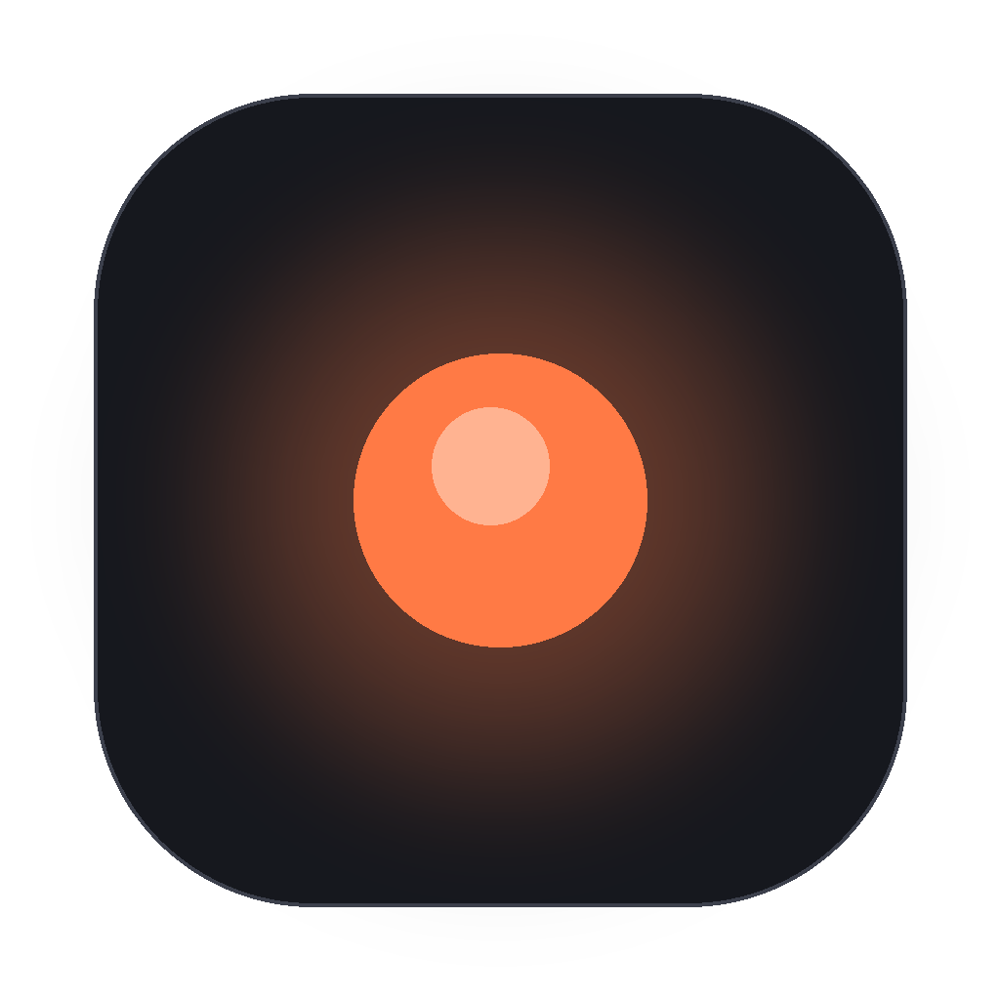

# Dot

**Qwen3.8-27B, entirely on your Mac.** One window. Zero settings. Nothing leaves this machine.

Dot is a tiny native macOS app (Swift/SwiftUI, ~1 MB) that runs a frontier-class local
AI model with voice in and voice out — no accounts, no cloud, no subscriptions, no telemetry.



## Get it (one button)

1. Download **Dot.dmg** — [direct link](dist/Dot-1.0.0.dmg) · or from the [latest release](../../releases)
2. Drag Dot to Applications
3. Open it *(first time only: right-click → Open, since the app is ad-hoc signed)*

That's it. Dot then takes care of the rest automatically:

- fetches the **llama.cpp** inference engine (~30 MB, official release binary)
- downloads **Qwen3.8-27B** (16.8 GB, Q4, Apache-2.0) with live progress — resumable if interrupted
- loads it on your GPU (Metal) and you're chatting

> **Requirements:** Apple Silicon Mac (M1 or newer), macOS 15+, ~48 GB RAM recommended
> for the 27B model (24 GB works, slower). Internet needed once for the downloads.

## What you get

| | |
|---|---|
| 💬 Chat | Streaming tokens, markdown, thinking shown in a dimmed collapsible block |
| 🎤 Talk | On-device Apple speech recognition — dictation, private |
| 🔊 Voice replies | Native Apple premium-voice TTS, speaking sentence-by-sentence as tokens arrive |
| 🧠 Thinking control | One button: Qwen3.8 *low* effort (fast + thorough) ↔ off (fastest, chores) |
| 🚫 Zero settings | No menus, no config files, no API keys, no accounts |

## Why it's fast

Dot is tuned for Qwen3.8 on Apple silicon (see [the Qwen3.8 field guide](https://lmstudio.ai/blog/splash-engine) for background):

- **`reasoning_effort: low`** — Qwen3.8's template defaults to *xhigh* thinking and burns minutes on trivial asks; Dot pins *low* by default and lets you disable thinking entirely
- **KV prefix caching** — a short, constant system prompt plus llama.cpp's `--cache-reuse` keeps repeat prefills near-free
- **Flash attention + q8_0 KV + 32K context**, full Metal offload
- **True SSE streaming** — first token lands instantly
- **Field-guide sampling** — thinking 1.0/0.95 · instruct 0.7/0.80

### Even faster: Splash

For maximum speed, run **Splash** (Inco AI's purpose-built Metal engine, ~74 tok/s on
M5 Pro) inside LM Studio Bionic, enable its local OpenAI server, then start Dot with:

```
DOT_LLM_URL=http://127.0.0.1:<port> open -a Dot
```

Dot detects the external endpoint on launch and uses it instead of its bundled engine.

## Privacy

Everything stays on your machine:

- inference: local `llama-server` (Metal)
- speech-to-text: Apple on-device recognizer
- text-to-speech: Apple `AVSpeechSynthesizer`
- the only network traffic is the one-time model download from Hugging Face

## Build from source

```
bash build.sh        # needs Xcode command line tools; produces Dot.dmg
```

No dependencies. Five Swift files:

| File | Role |
|---|---|
| `src/App.swift` | Window + dark mode |
| `src/ChatView.swift` | The whole UI |
| `src/Engine.swift` | Engine discovery/fetch, model download, tuned requests, SSE streaming |
| `src/Speech.swift` | STT + TTS + sentence chunking |
| `src/Models.swift` | Data types |
| `src/Autotest.swift` | Invisible verification harness (`DOT_AUTOTEST=1` or `~/.dot/autotest` marker) |

## How the model is picked

The default model is `JonathanColetti/Qwen3.8-27B-Uncensored-GGUF` (Q4_K_M, ~16.8 GB)
from Hugging Face — the Apache-2.0 Qwen3.8-27B base, uncensored finetune, imatrix quant.
Swap `modelFileRelPath` / `modelDownloadURL` / `expectedModelBytes` in `src/Engine.swift`
to use any other GGUF (or a smaller Q4 for 24 GB Macs).

## License

MIT — do whatever you want with it.
