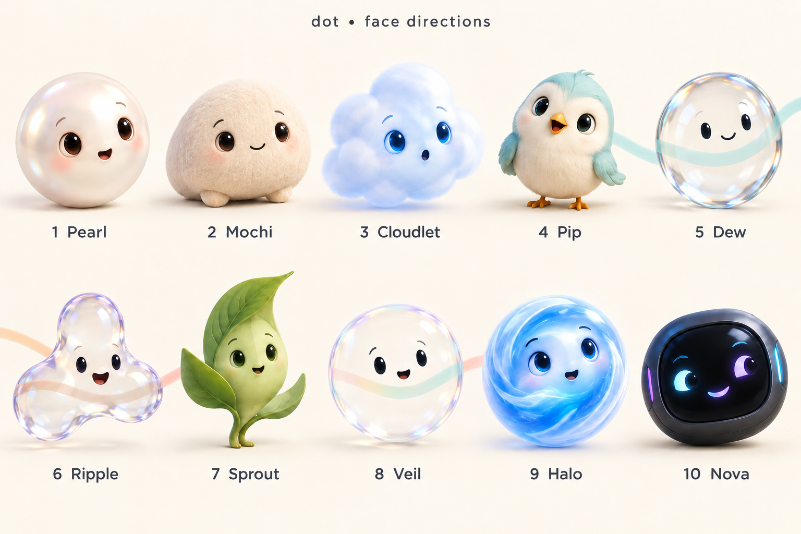

# dot: product roadmap and build checklist

Agreed direction, updated 2026-10-14. **This is the canonical future-product checklist.** [PROGRESS](PROGRESS.md) records verified source, tests and installation; agreement here does not mean a feature is built. Roadmap capability boxes remain unchecked until their stated scope is verified; the separate candidate ledger below records narrower source and automated-check milestones. This documentation delta changes no application code; the preview review is complete and checklist implementation is authorized in tested stages. Voice is the first milestone, with a separate reviewable native skin/settings batch; installation remains a separate step.

dot is a very fast, voice-first, Apple-native macOS AI companion. **Speed comes first; a warm, calm, high-quality British female voice generated locally comes second.** It should understand relevant work, research facts, act helpfully and feel alive. Prefer Apple-native solutions and frameworks for every subsystem; use custom components where necessary or demonstrably better under these requirements. This principle preserves the fixed Splash/Qwen LLM and the required British voice.

Latest planning update, 2026-10-13: the user welcomed the suggestions for persistent tasks, verified actions and source-backed research, and requested **as little custom code as practical**, smooth behavior and publication of all planning deliverables. The user then explicitly approved starting with **the configurable listening and question follow-up loop**. Speech beginning within the invitation window continues until the selected trailing-silence rule; the invitation duration is not an utterance cutoff. The broader workflow recommendations below remain roadmap items, not completed capabilities or a promise to deliver the entire roadmap today.

**Current implementation authorization:** the owner reviewed the designs, selected all ten new skins alongside Original, and explicitly said **“yes build app based on our checklist.”** The earlier hold and first-voice-only scope limit are superseded. Proceed through the checklist in tested stages, beginning with the listening/question-follow-up loop and native Settings, with a separate reviewable skin/animation batch. Do not ask for the same start approval or require a new theme choice. Preserve existing work and the installed app; implemented source and a successful build do not themselves establish installation or owner acceptance.

**Planning deliverables:** [plain-text checklist](BUILD_CHECKLIST.txt) · **[approved-lineup v3 concept board](design/dot-face-directions-v3.png)** · [v3 generation prompt](design/dot-face-directions-v3-prompt.txt) · **[interactive motion study](design/dot-face-motion-directions.html)** ([download HTML](https://raw.githubusercontent.com/Emin-dev/Dot/main/docs/design/dot-face-motion-directions.html); save and open in a browser) · [prototype validation report](design/dot-face-motion-validation.md) · [artifact index and history](design/README.md). The v3 board, motion export and report are delivered. The [v2 board](design/dot-face-directions-v2.png) and [unchanged v2 prompt](design/dot-face-directions-v2-prompt.txt) remain historical pre-Veil material showing the replaced Fold. The [first interactive preview](design/dot-ui-options.html) is also historical exploration.

**Agreed skin target:** **11 selectable choices in native Settings**: the existing **Original**, followed by ten new skins **Pearl, Mochi, Cloudlet, Pip, Dew, Ripple, Sprout, Veil, Halo, Nova**. **Original remains the default until the user changes it.** Veil replaces Fold at position 8: a very thin, nearly invisible transparent bubble/lens, similar to Dew but more transparent, with a sparse face, faint rim and visible backdrop; no fox or folded-paper form. The new grouping is four rounded, three glass, one Sprout and two AI-style skins. This design decision alone is not implementation evidence; a first native candidate is now separately recorded below. Each new skin requires at least **120 reviewed, visibly distinct, context-appropriate named animation recipes**, each with trigger, duration, compatible states and cancellation behavior. Actual playback alignment and runtime performance require separate tests; a static board or Cartesian-product count does not complete the library.

**Latest facial-expression requirement:** all 11 faces must remain smiling, warm and user-friendly across every state, including focus, thinking and research. Use rounder open eyes with highlights, relaxed gently arched brows and a gentle upturned resting mouth. No angry inward V-brows, glaring slit eyes or scowls. Speaking should articulate friendly mouth shapes; keep truthful task labels independent of facial expression. Preserve each identity, Veil, Original as default and the 120+ reviewed named animation-recipe target per new skin.

**Motion preview status:** the corrected warm-face HTML and updated validation report are now delivered. Rounded eyes/highlights, relaxed arched brows, upturned smiles, friendly speaking poses, Sprout arms, Pip beak and Nova eyes were revised; layout now uses aligned equal-width actions, shorter labels and less excess stage height. Author checks passed for all 1,200 configurations, 120 distinct painted tuples per face, friendly parameters, eight speaking shapes, state/echo, no autoplay and Reduce Motion. **The owner has accepted the corrected design and confirmed continued implementation.** No fresh browser pass was available: earlier 736/390/320 px checks apply only to the pre-correction version. Owner design acceptance, fresh technical browser verification and native/hardware acceptance are distinct.

**Owner design acceptance:** after viewing the corrected preview, the owner said **“yes all good build app now.”** The corrected design is accepted and implementation continues without another approval gate. This is separate from technical browser verification: no fresh browser pass was available for the correction, so earlier 736/390/320 px checks still apply only to the pre-correction version. It is not acceptance of the native candidate or installed hardware behavior.

**Standing documentation rule:** add new feature decisions and refinements to this canonical checklist and publish the updates to GitHub as they are discussed. The app should follow the current checklist. Record pending work honestly; do not wait for implementation to document an agreed requirement. Keep implementation authorization and evidence separate from documentation publication.

**Continuation checkpoints:** while implementation is active, at safe checkpoints approximately every ten minutes publish meaningful updates to this checklist and its text companion, PROGRESS, [CONTINUATION](CONTINUATION.md), and other affected Markdown documents. Record exact revisions, ownership, recovery state, passed/failed/unrun checks, blockers and next executable steps. Preserve unfinished source in a verified durable ignored workspace checkpoint as well as any temporary copy; do not publish broken code merely to checkpoint, create empty timestamp-only commits, or interrupt correctness checks unnecessarily. One integration owner publishes normally on main.

**Standing repository workflow:** `main` is the single ongoing working branch and GitHub default branch. Do not create new feature/release branches or maintain parallel development branches. Parallel agents use explicit non-overlapping file ownership on main, or temporary detached checkouts when isolation is needed; one integration owner reviews and integrates their changes on main. That owner controls staging, commits and normal non-forced pushes. Inspect active writers, base revisions and local changes first; stage only the intended reviewed files. Never force-push, reset/discard unfinished work, overwrite concurrent edits or replace a dirty workspace with a snapshot. Preserve existing recovery copies and dirty historical checkouts; a branch-policy change is not permission to delete their contents.

**Delivery expectation:** the user explicitly requests building, testing and delivering the full agreed checklist before the final hand-off. Treat verified milestones as progress, not task closure. Continue through the remaining work in measured stages; retain each conditional research, quality, hardware, signing and distribution gate, and report concrete blockers or unrun acceptance honestly. Agreement, a merge or a successful build is not proof of whole-product completion. Keep source, automated/native checks, installation and owner acceptance separate; installation remains its own clear step.

## Scoped progress checkpoint — 2026-10-14 16:16 UTC

This documentation tranche records **4 of 97 current requirements complete, 93 open**, plus **five separate historical milestones**. The completed scopes are R04 **dated reconciliation**, R17 service-boundary **design**, R50 video **feasibility research**, and R66 **shared-native-rig architecture**. These counts are not a feature-completion percentage or release certification. R04 closes only the fresh dated reconciliation; it must continue to be maintained as commits, tests and prerequisites change. All 102 requirement texts and their order are preserved.

- Published parent for this combined candidate is [`21fb1c2`](https://github.com/Emin-dev/Dot/commit/21fb1c24d2d061bd46995d7cfcd7e6a4c8c40432), tree `dc737d2237170e50675a6b0187f3feb0c1c92065`, 238 files. Its canonical ledger still has **0 of 97 current rows checked**; the expanded local ledger has **4 of 97** after the approved dated R04 reconciliation. This tranche adds the four approved scoped closures and their reports without copying the expanded implementation.
- Latest exact green hosted-native evidence is [`21fb1c2`](https://github.com/Emin-dev/Dot/commit/21fb1c24d2d061bd46995d7cfcd7e6a4c8c40432): **334 Python passes / 3 skips, 486 SwiftPM and 789 XCTest passes**, plus Debug/Release/development-package/signature and the zero compiler-warning gate. [Run 38594414249](https://github.com/Emin-dev/Dot/actions/runs/38594414249), [job 115957311020](https://github.com/Emin-dev/Dot/actions/runs/38594414249/job/115957311020), completed successfully at 16:11 UTC. This is model-free evidence for that exact parent; runtime diagnostics remain distinct from compiler warnings.
- Earlier failed attempts: [`2d28437`](https://github.com/Emin-dev/Dot/commit/2d28437a560638074eb9c835349990dcaea3cba2) passed **333 Python / 3 skips and 486 SwiftPM**, then failed native compilation on the unused mutable weak binding in `ResearchEngineTests.swift`; XCTest and packaging were not reached. The minimal `f0a0751` repair cleared that compiler warning, but [run 38589346500](https://github.com/Emin-dev/Dot/actions/runs/38589346500) **failed at 15:32 UTC**: **333 Python passes / 3 skips and 486 SwiftPM passes**, followed by **788 XCTest cases with 11 failures (2 unexpected) across four new transport cases**. Release/package/signature gates were not reached. These historical failures are superseded by the exact green `21fb1c2` parent; they remain recorded rather than being relabelled as passing.
- [Scoped evidence and reconciliation](verification/scoped-progress.md) links the exact [service-boundary design](architecture/staged-services.md), [video feasibility research](verification/video-feasibility.md), and R66 native evidence. The broader Rust migration, video implementation/Mac acceptance, production expression recipes, native integration, full runtime/device checks and distribution gates remain open.
- The expanded local source and its `scripts/current_product_acceptance.py` validator are absent from this published base and are not added by this documentation delta. This documentation delta includes no release infrastructure, app/test code, payload, signing, installed-app or binary-delivery changes. Historical native passes do not validate that expanded source.
- The combined candidate separately contains **19 reviewed HTTPS-evidence paths plus these seven documentation paths**. Its **343 portable cases / 339 passes / 4 skips and 52 static guards** passed; all 59 prior Engine native test names and assertions are preserved; one existing exact-limit test and its helper add phase timing. The parent's green native result does not certify the combined HTTPS delta; its exact hosted-native run remains the next verification step. No binary delivery is included.

The earlier checkpoints below are preserved as dated historical evidence; this scoped checkpoint supersedes their current-state wording.

## Cloud continuation checkpoint — 2026-10-13 20:11 UTC

Development now continues on an independent Linux cloud checkout and GitHub's hosted macOS CI. The owner's Mac is intentionally not a development dependency; its installed application and data have not been inspected or changed. Main remains the only ongoing branch, with one integration writer. Earlier Mac workspace and candidate paths below remain historical preservation records, not current active execution.

- Published diagnosis: `6ff1497a57a4fe55fa912db1dcf1410f984b490b` added bounded bootstrap failure output and unconditional fixture pipe cleanup. [Native run 38459877171](https://github.com/Emin-dev/Dot/actions/runs/38459877171) proved that Homebrew Python's external `libssl.3.dylib` was blocked by the existing sandbox. No product sandbox allowance was expanded.
- Published test-toolchain fix: `f8a66e799826b8abcca88f077a9f5f1a501e3898`. [Native run 38460428778](https://github.com/Emin-dev/Dot/actions/runs/38460428778) passed **all 158 Python tests**, including the real bootstrap/TLS/EOF fixture, both exact sandbox probes, and **52 static guards**. It then failed Swift compilation because the runner's default Xcode 16.4 SDK lacks `IntentModes`. This checkpoint explicitly selects the already-installed Xcode 26.3 and prints toolchain/SDK provenance. Full native results for this checkpoint are pending.
- Included reliability changes: destructive local-record deletion now requires a Cancel-default, target-bound, single-use confirmation; close/reopen, selection/revision changes and new history writes revoke stale requests. Shutdown permanently closes native-action admissions and awaits durable receipts; stale native picker callbacks cannot target a reopened panel. Follow-up searches stop before discarding an answer when source/text/byte capacity is full. Local-Qwen evidence allocation budgets actual JSON-encoded UTF-8 while preserving complete graphemes.
- Available cloud checks passed: **158 Python tests with one explicitly skipped macOS-only fixture**, **52 static guards**, shell syntax and whitespace checks. Added Swift/native regressions are source-reviewed but cannot execute on Linux; the exact integrated hosted native run is required before claiming they pass.
- Remaining implementation lanes include isolated free/keyless SearXNG with transient discovery versus permitted source persistence, DNS-pinned public-source transport, consolidated evidence/memory/tasks, resumable verified workflows, event-aware assistance, expression/performance refinements and release compliance. No live SearXNG provider, all-checklist completion or final installer is claimed by this checkpoint.
- Owner-dependent native/acoustic/installation checks are retained at the end of the canonical checklist for later owner testing. Continue every independent implementation and compatible test in the meantime. Public distribution still requires exact source/license closure, suitable artifact verification, signing/notarization and supported delivery. Do not weaken acceptance or hand off the model-free development DMG as the final working app.

## Reliability review and next acceptance order

The owner requested this quality review be added to GitHub before continuing implementation. The review originally inspected `f718e870`; the initial recheck used `29cfafc`/`6aa5b89`. The new `125e0e9` source milestone resolves several findings below, with exact automated evidence separated from remaining device acceptance. Work in progress is not merged, installed or accepted merely because a focused test passed. This ordering preserves the full checklist authorization and the main-only workflow; it introduces no new start or design approval gate.

**Order:** clear voice/status/recovery and accessibility → screenshot/history/cancellation correctness → exact assembled runtime, acoustics/performance and helper boundaries → one complete cited research workflow → broader retrieval/memory/tasks/actions/proactivity. Preserve existing parallel work rather than discard it. Keep independent reliability lanes active; avoid unrelated refactoring, unnecessary app restarts or replacing the fixed model, voice or Original default.

| Review item | Rechecked current status and required completion evidence |
| --- | --- |
| 1. Reliability before expansion | Fixed model/voice and 11 identities remain. Preserve unfinished features; integrate them only after their dependencies and relevant reliability checks pass. |
| 2. Readable actual state | `125e0e9` implements compact actual state, Stop and invitation/silence countdowns from capture deadlines, with native/coordinator tests. Complete exact assembled-device interaction acceptance remains. Researching/acting/success require actual operations. |
| 3. Capture recovery | `125e0e9` distinguishes cancellation/no speech/route/audio failures with bounded recovery and typed text fallback. Physical failure-mode acceptance remains. Expose screen-permission guidance and Continue without screen; label when Retry starts a new recording. Diagnostics exclude recordings, transcripts, screenshots and secrets. |
| 4. Motion versus feedback | `125e0e9` separates inactive decorative/travel suppression from active listening/speaking feedback; exact assembled desktop acceptance remains. Explicit Still and Reduce Motion remain respected with static readable status. |
| 5. Accessibility/discovery | `125e0e9` publishes dual-tone facial/control contrast, first-use guidance and keyboard/Options discovery. Source render evidence is separate from WindowServer acceptance. Complete Increase Contrast and white-document/dark-editor/photo checks, Options in menu bar, first-use hint, keyboard access and typed interaction when voice is unavailable. A compact character gallery is a consideration, not an approved completed feature. |
| 6. Screenshot freshness | Fixed in `125e0e9`: conservative monotonic acquisition timestamp survives encoding and is checked before submission; slow/stale/cancelled fixtures pass without screenshot retention. Actual capture/device matrix remains. |
| 7. Accurate history | `125e0e9` adds durable local history separating generated/spoken/interrupted/failed delivery, including typed voice-failure continuation, restart and stale callbacks. Installed baseline remains RAM-only; memory integration is separate. |
| 8. Exact real voice loop | Synthetic and model-free native tests cover many boundaries, but do not establish full exact-candidate runtime acceptance. Exercise ordinary/genuine/rhetorical/question-only responses, malformed streams, interruptions, chain limit and timing boundaries; Stop/hide/drag/menu/sleep/permission/route cancellation. |
| 9. Acoustic/performance evidence | Cold/warm p50/p95, actual audible onset, STT/readiness/generation/synthesis/cancellation/queue pressure, RAM/CPU/GPU/thermals/idle energy remain required. Exercise quiet speech/noise/echo/headphones/Bluetooth. Use measured failures to choose detection/echo improvements and add replayable coordinator tests; scheduled playback and amplitude are not acoustic/phoneme measurements. |
| 10. Helper/tool boundaries | `2db5aa9` tightened helper filesystem/socket boundaries with required/forbidden probes and real runtime acceptance; `125e0e9` reruns those exact fixtures. Full process/Mach containment is not claimed. Screens/web/documents/model output remain data, never tool authority. Preserve applicable OS/tool constraints and the user's settled autonomy preference; no invented repeated-confirmation policy or second heavyweight model. |
| 11. Meaningful expression library | Unfinished shared library has 120 authored trajectories and native render evidence; final character-specific perceptual, real-trigger/cancellation/playback and device/performance acceptance remain. All ten new skins need at least 120 reviewed meaningful warm recipes, truthful success and articulated speech. Shared-label or pixel-combination arithmetic is insufficient. |
| 12. Complete research first | URL/PDF/local-source notebook modules have focused fixture tests but are not a complete question-to-search workflow. Deliver searches → actual source reading → date/claim/conflict checks → citations → local evidence, with interruption/resume and uncertainty. Resolve search provider/cost before any paid commitment. Then integrate retrieval, editable/deletable memory, durable tasks, typed actions, verified outcomes and deduplicated help. |
| 13. Exact verification/reporting | Check native light/dark/accessibility/permission and interaction states. Show readable results and Sources/Open/Resume/Undo only when supported. Record source/test/merged/installed states separately; CI, real-device and clean-Mac acceptance remain distinct. Preserve installed app until a separately authorized replacement. |

- [ ] Complete the above reliability and interaction corrections with focused regression tests.
- [ ] Complete exact assembled-app and actual-runtime voice acceptance and reproducible acoustic/resource measurements.
- [ ] Complete the first end-to-end research workflow before claiming broad autonomous research/tool capability.
- [x] Reconcile this ledger with exact commits, tests, device checks and concrete unresolved prerequisites as work proceeds.

**Current practical verification limits:** the separate `6aa5b89` candidate was launched and all 11 actual native windows captured without clipping; isolated offline-payload readiness was 18.64 seconds. No inference or speech was started in that check. It also emitted intermittent layout/shortcut-registration diagnostics, retained for investigation. Accessibility and synthetic-input access were unavailable, so actual menu and physical voice acceptance did not run. Fresh browser inventory was empty. These limits do not revoke owner design acceptance or block available source/native checks. No current-device voice-loop or latency claim follows from prior synthetic/earlier-revision results.

## Active integration checkpoint — 2026-10-13 19:08 UTC

**[Reliability/history/native utility milestone](verification/reliability-history-research.md)** is verified at `125e0e9`: **158 Python, 346 SwiftPM, 577 native XCTest, 52 static checks**, exact sandboxes, Debug/Release/development packaging/signature, zero warnings. Visible state/recovery, typed voice-failure continuation, durable delivery-aware history, screenshot freshness, source/notebook/actions utilities and provider-neutral research integration are source-implemented. Live provider setup/full searched answer, final native/acoustic acceptance and whole-product completion remain pending. App Intents metadata/training is packaged; Siri discovery is unrun. Complete separate offline assembly is underway; installed app unchanged.

The older exact-helper component benchmark remains distinct: five warm public synthetic turns, **5.442 s median to player start including selected 3-second silence**, 5.723 s empirical p95/max (n=5); post-silence median 2.418 s; one cold readiness **63.875 s**. These are not acoustic onset, a general performance promise or this newer candidate's timing. The earlier focus QoS warning did not recur in the exact-source gate or 12-check native keyboard replay. Source rendering passed 160 renders/22 assertions; WindowServer compositing remains inconclusive. Provider choice remains unanswered with no paid/live calls. See [CONTINUATION](CONTINUATION.md) for recovery, six active lanes and subsequent uncommitted proactivity/budget/memory/task work.

## Short improvement checklist

- [ ] **Fast voice first:** keep the chosen local model and British voice; measure the complete conversation path and let background work yield immediately to conversation.
- [ ] **Finish useful work:** persistent missions with a clear result, progress, pause/resume, restart recovery and checked outputs.
- [ ] **Remember with evidence:** editable local memory tied to source passages and dates, including corrections and stale information.
- [ ] **Research once, refresh intelligently:** a local evidence notebook with sources for individual claims, dates, disagreements and reusable findings.
- [ ] **Resume a project:** relevant files, recent decisions, unfinished tasks and a concise next-step or handoff pack.
- [ ] **Make documents useful:** watched-folder workflows, native PDF text and structured on-device recognition of scanned tables and lists.
- [ ] **Reuse reliable actions:** small tested native workflows for supported apps, with observable success and recovery where possible.
- [ ] **Offer timely help:** the requested 1 / 4 / 10-minute presets, default 1; prioritize useful changes, remember dismissals and avoid duplicate work.
- [ ] **Make the UI actionable:** old design plus ten new looks, expressive speech, clear activity states, source chips, task results and keyboard access.
- [ ] **Build less custom infrastructure:** Apple frameworks first, thin adapters, one shared model, one local store and measured staged Rust migration.

These short-list and roadmap boxes describe the full target capability. The candidate ledger below may mark narrower source/check milestones without claiming installation or full product completion.

## At a glance

| Area | Agreed target; not a completion claim |
| --- | --- |
| Local AI | Qwen 3.8 27B Q4 through Splash; current pinned baseline Splash 1.3.1 with target, draft and vision assets |
| App architecture | SwiftUI/AppKit UI, Rust core/coordination/tools/research/history, thin Swift Apple-framework adapters; staged migration measured against the working app |
| Speech | Local British female voice, Kokoro `bf_isabella` quality reference; benchmark native speech candidates without silently substituting voices |
| Turn ending | Configurable continuous silence **2 / 3 / 5 / 8 seconds; default 3**, before reasoning or research on the utterance |
| Question replies | After an actual final audible question, **3 / 6 / 9 / 12 / 20 seconds; default 6**, to begin speaking |
| Proactive activity | Native options: **Low every 10 minutes / Normal every 4 minutes / High every 1 minute; default High**; randomized question timing still to design |
| Context and research | Automatic screen awareness, relevant accessible files and background observation; internet always available for research, local AI processing/speech/memory |
| Pet and UI | Compact native UI, richer personality, safe routes plus tiny local idle-motion fallback; **11 native Settings choices: Original (default) plus ten new skins**, including Veil instead of Fold |
| Tools and records | Mac/browser/file/coding tools, verified outcomes, durable local text history, editable memory and project/task context |
| Delivery | Preserve complete offline owner bundle; future public verified first-launch downloader, hardware gates and proper distribution acceptance |

## Implementation authorization and sequencing

The user first approved the listening/question loop, paused to review the face options, then confirmed continuation and subsequently authorized **building the app based on this checklist**. The first voice slice is a milestone, not the overall implementation scope limit. Work through the approved checklist in tested stages; ask only when genuinely needed information or a material unresolved choice blocks work. The ten new skins and Original default are already decided.

1. Publish new decisions and delivered planning artifacts, keeping recommendations, implemented source, tested behavior and installed behavior separate.
2. Complete configurable trailing silence and question-only follow-up listening with native options, persistence, cancellation, final-audio gating and focused tests.
3. Use several parallel agents with non-overlapping file ownership, shared interfaces and one integration owner on main; temporary detached checkouts may isolate work without creating feature branches. Keep skin/settings and other milestones separately reviewable, and let the integration owner stage/publish only the intended changes.
4. Preserve Qwen/Splash and the British Kokoro voice. Keep Original as the default and add all ten selected skins; no further theme-selection question is needed. Continue through usable screen/pet, proactive scheduling, local records, research and verified-tool workflows, with measured staged Rust integration.
5. Continue building, testing and delivering the full agreed checklist before final hand-off; an individual milestone is not completion of the task. Conditional research items retain their feasibility, quality and hardware gates. Do not replace the fixed speech/model baseline without satisfying its conditions or claim unresolved/blocked work complete.
6. Report exact revisions, checks and remaining device acceptance. Building or publishing a candidate does not change the installed app. Installation is a separate clear step; preserve the working installed app and unpublished UI patch.

The first batch retains the existing Swift coordination and native Apple adapters. Persist and validate both timer settings, including defaults/migration. Use monotonic deadlines for silence and invitations, test speech starting at the invitation boundary, and retain the normal 60-second capture/sample bounds. Full successful generation and final synthesis/playback completion must gate validated turn-bound question intent; intermediate queue drains and punctuation alone do not grant microphone authority. Respect existing microphone permission and route state without repeated or spontaneous OS permission prompts; invalidate stale work on replacement turns, Stop, hiding/Quit, sleep, route/permission loss and relevant drag/menu transitions.

Implementation authorization now covers the broader checklist in tested stages; it does not remove the existing fixed model/voice choices, feasibility gates or separate installation/release acceptance. Keep the first voice milestone bounded for review and integrate broader features in subsequent or non-overlapping batches. Profile the preserved baseline when available; distinguish selected silence, post-silence processing and first actual audible response, and do not claim improvement without comparable measurements.

The owner accepted the corrected design and confirmed building; inclusion/default decisions are settled. A fresh technical browser pass remains unrun and is not a new implementation approval gate. Open rendering details or conditional research choices do not reopen settled skin selection. Design acceptance and browser prototype checks are not native implementation or device-test evidence.

## Verified baseline and preserved work

| State | Evidence and limits |
| --- | --- |
| Main versus tested candidate source | `main` is the single ongoing/default branch. [PR #2](https://github.com/Emin-dev/Dot/pull/2) merged normally at [`f718e87`](https://github.com/Emin-dev/Dot/commit/f718e870cd14148c1b20c03c7adc822f9981bf31); exact tested source remains [`6aa5b89`](https://github.com/Emin-dev/Dot/commit/6aa5b89a8fa6ede0dca2c65a03a80221b566b0bc). The assembled candidate is uninstalled; later main work needs its own checks |
| Installed personal app | [`b26a145`](https://github.com/Emin-dev/Dot/commit/b26a14505bd2bc8e57264f1dfc934f778a8bd781), assembled, signed, installed and launched; later prose does not change its executable |
| Exact installed-source checks | [CI](https://github.com/Emin-dev/Dot/actions/runs/38417684255) and native verification: 190 XCTest, 109 SwiftPM, 129 Python, 44 static guards; zero warnings; real Whisper linking and complete assembly passed. Suites overlap; do not sum them as unique tests |
| Device/owner acceptance | Historical owner-confirmed voice and real screen-aware replies; the installed repair produced a permitted placement map. Fresh owner smoke test, broader physical drag/multi-display/Space use and clean second-Mac acceptance remain open |
| Preserved compact UI work | Original nine-file recovery patch remains preserved and its hash was rechecked. Its earlier result tree was `d0f53b46f9b4573fb6d4383caae8185ddab31dbe` on `1d04b89`; historical 129 Python/48 guards did not include new native tests. Compact diagnostics and Show Dot/Quit work were tested in the exact candidate and merged to main; the installed app is unchanged |

Preserve original dirty workspaces, installed app, history and the unpublished patch. Inspect active writers and the intended integration base before applying it; never replace current files wholesale with an older snapshot. Do not reclassify historic checks as tests of a future merge.

## Merged milestone — exact candidate source and checks only

**[PR #2](https://github.com/Emin-dev/Dot/pull/2) merged normally to main at [`f718e87`](https://github.com/Emin-dev/Dot/commit/f718e870cd14148c1b20c03c7adc822f9981bf31).** The exact tested/assembled source remains [`6aa5b89`](https://github.com/Emin-dev/Dot/commit/6aa5b89a8fa6ede0dca2c65a03a80221b566b0bc); that candidate is **not installed or hardware-accepted**. The following evidence belongs to that revision and does not certify later uncommitted main work. The [exact-revision source receipt and native contact sheets](https://github.com/Emin-dev/Dot/blob/6aa5b89a8fa6ede0dca2c65a03a80221b566b0bc/docs/verification/voice-and-native-skins.md) describe the slice and remaining acceptance. The installed `b26a145` executable and original recovery-patch hashes were confirmed unchanged.

- [x] **Candidate source/checks:** persisted native silence choices 2/3/5/8 seconds (default 3) and question invitations 3/6/9/12/20 seconds (default 6); monotonic capture deadlines, resumed-speech resets and serialized boundary handling. Only satisfied silence submits the next transcription/LLM turn; the 60-second limit does not submit an unfinished utterance.
- [x] **Candidate source/checks:** explicit validated turn-bound question intent, successful terminal generation and final ordered synthesis/playback barrier, bounded invitation and cancellation. A reply begun in time continues to selected silence within capture bounds. Permission/route/stale-callback protections are implemented; actual echo and device-route behavior remain hardware gates.
- [x] **Candidate source/checks:** compact diagnostics/Show Dot/Quit integration and 11 persisted native appearance choices with Original default. Five shared named friendly phase recipes and current-player amplitude-driven mouth motion are implemented; this is not phoneme alignment or 120 reviewed recipes per skin.
- [x] **Exact-revision verification:** `verify_macos.sh` passed **129 Python, 175 SwiftPM, 277 native XCTest and 49 static guards**, exact voice/Splash sandbox checks, Debug/Release and development packaging, with **zero warnings**. Suites overlap; do not sum them as unique tests. These results do not certify real microphone/speaker behavior.
- [x] **Candidate assembly:** complete offline candidate assembled from existing assets; real Whisper linking, full runtime/model audits and strict signature verification passed. No model downloads, runtime upgrades or asset replacements. The candidate is ad-hoc signed, not notarized or installed.
- [ ] **Candidate hardware/owner acceptance:** microphone/speaker echo, Bluetooth/headphone route changes, denied/revoked permissions, interruption transitions, full bundled conversations and measured actual-audible latency. Native static light/dark/opaque contact sheets were reviewed; they do not certify runtime motion, accessibility delivery or GPU/energy behavior.
- [ ] **Installation/release:** the installed `b26a145` app remains unchanged. Candidate source availability, tests, assembly, installation and owner acceptance are separate states; no public release is claimed.

The source retains provisional implementation choices of a 400 ms playback-to-capture settling interval and a three-auto-reply cap per manual conversation. Product chain policy and measured echo behavior remain open; tests do not turn those values into final product decisions. The next expression-library and durable-history stage is preserved as unfinished work on main, with recovery copies; it is **not complete or covered by these exact-revision results**. The 120+ production recipe target, durable history/memory, proactivity, research/files/tools, tiny-motion fallback and staged Rust services remain unchecked.

## Architecture and performance

Current coordination is Swift and remains appropriate for the resumed bounded voice slice; a Rust rewrite is not a prerequisite to shipping that tested slice. The working voice path is native whisper.cpp `base.en` batch transcription, a bundled Python/Kokoro helper, and AVAudioEngine/AVAudioPlayer; placement uses ScreenCaptureKit/Vision. The requested Rust service core is not implemented. Splash remains the inference runtime: changing orchestration language does not by itself make model inference faster.

- [x] Design staged Swift/Rust service boundaries for coordination, tool execution, research, indexing, history and memory; keep Apple framework adapters thin and the UI responsive.
- [ ] Keep Qwen 3.8 27B Q4, Splash 1.3.1 baseline and pinned target/draft/vision assets. No alternate cloud LLM or Apple Foundation Models replacement has been authorized. The `mlx-community` checkpoint publisher name is not an inference-engine switch.
- [ ] Jointly benchmark streaming STT candidates **Parakeet EOU** and **Apple SpeechAnalyzer**, including recognition quality, offline asset provisioning and contention with Splash. No winner is established.
- [ ] Evaluate native Core ML Kokoro only if it matches the desired British female voice and outperforms the working path. Keep `bf_isabella` as the quality reference. Exact identity versus a sufficiently similar British voice is open; an American-only substitution is unacceptable.
- [ ] Consider Apple built-in speech as an optional native speech profile; do not promise access to Siri's exact voice. Core ML is being considered for speech, not as a replacement for Splash/Qwen.
- [ ] Measure resident-model policies, prefix caching, streaming STT, sentence TTS, reduced copying/IPC, prioritization and cancellation. Keep animation/placement cheap and independent of the 27B model; do not run multiple 27B models for background tasks.
- [ ] Benchmark speech and Splash together across GPU/ANE/memory contention, quality, heat, battery and RAM. Keep full payload integrity, process ownership and cancellation checks.
- [ ] Report speech-end to **first audible response including the selected silence interval** (default three seconds), post-silence processing separately, cold/warm readiness, interruption latency and p50/p95. Scheduled playback is not measured audible sound. Deep research can take longer. No fastest-pipeline result, guaranteed three-to-five-second answer or Rust speed multiplier is established.

## Conversation and native options

- [ ] Expose trailing-silence choices **2, 3, 5, 8 seconds, default 3**. Require uninterrupted silence for the selected duration before reasoning or web research on that turn. Resumed speech resets the timer. Streaming transcription may run while listening; do not reason on an unfinished utterance. Pause/deprioritize background reasoning on foreground interaction.
- [ ] Expose question invitation choices **3, 6, 9, 12, 20 seconds, default 6**. This is the time to **begin speaking after dot's final audible question**, not TTS duration or maximum utterance length. No speech closes the microphone; speech begun in time continues until the selected trailing-silence threshold, subject to ordinary capture/sample limits (current overall bound: one minute).
- [ ] Use validated explicit question intent and successful complete generation plus **all final question audio actually finished** before arming the mic. Punctuation, quotations or rhetorical questions alone cannot arm it. An intermediate audio-queue drain is not final completion.
- [ ] Bind intent, synthesis, playback and capture to the current turn with stale callback cancellation, one-time continuation authority, echo protection and fresh microphone permission. No automatic OS permission prompt. Stop/click replacement, drag/menu, hiding, Quit, sleep, route changes and permission loss cancel pending listening.
- [ ] Apply the same bounded invitation to random proactive questions after their audible completion. There is no independent random microphone opening without a question.
- [ ] Preserve click-to-interrupt/Stop. Decide hands-free speech interruption, wake word, maximum automatic reply chain and measured echo-settle behavior; scaffold constants are not agreed product limits.
- [ ] Add these controls and the activity presets below in native settings/options. A compact native surface may preserve the style; exact presentation remains open. Earlier no-Settings-window wording must not erase the requested controls.

## Screen, files and online research

The user has authorized broad autonomous use of relevant screen content, documents/files, Work/Downloads, iCloud Drive and other accessible folders, including relevant screen/file information in web research. **Web requests may contain screen data; this permission is decided.** Local reasoning does not mean network-free web queries: online services receive the requests needed for research. No cloud LLM replacement or conversation-upload feature is authorized by this direction.

- [ ] Provide automatic screen awareness before answering and background observation without a fresh request, to discover useful context and proactively help. This expands the installed explicit-turn capture plus sparse local placement behavior; it is not installed today.
- [ ] Keep native permission grants, visible capture/pause controls and honest unavailable-context reporting. Broad autonomy does not bypass macOS consent, protected-system/keychain restrictions, provider rules or actual accessibility.
- [ ] Build a local file/document index with event/change-driven updates, relevance ranking, deduplication and background opportunity discovery. Avoid repeated whole-disk scans. Handle iCloud placeholders/downloads explicitly; accessible cloud documents are not necessarily already offline.
- [ ] Make online research/deep research the default before most factual answers and support automatic background research. Keep internet available as a product capability; report connectivity/provider failures honestly.
- [ ] Use multiple searches, actual page/PDF reading, original sources, publication/event dates, follow-up queries, conflict cross-checks and citations. Similar usefulness to Perplexity/ChatGPT is an aspiration, not proven parity.
- [ ] Add the requested free-only SearXNG option below; set research time/usage budgets and whether a quick provisional answer precedes full research. Do not imply permission to send relevant context remains undecided.
- [ ] Treat screen, website, PDF, document and model content as untrusted data. Reading it never grants authority to override the user's goals, expand permissions or issue tool commands.

AI processing, speech and durable memory remain local. Web retrieval is a separate network-capable service; keep the inference/speech isolation boundaries while designing it. Existing plans exclude stored microphone audio and screenshots; retention of learned text facts remains a design decision.

### SearXNG local metasearch integration

Requested on 2026-10-13; all items below remain unimplemented acceptance work.

- [ ] **Isolate the local search helper.** Run SearXNG on a validated loopback-only endpoint, separate from offline Qwen/Splash inference and speech. Keep reasoning local; search still contacts upstream internet engines. Use free-only engines, with no paid API or cloud LLM fallback.
- [ ] **Connect the provider adapter.** Enable JSON in SearXNG's `search.formats` and integrate `/search?format=json` with the existing provider-neutral research pipeline. Normalize URLs, titles, snippets and engine provenance; test malformed/empty/partial responses and disabled JSON (403). See the [official Search API](https://docs.searxng.org/dev/search_api.html).
- [ ] **Bound requests and fail honestly.** Enforce query/time/concurrency limits, timeouts, cancellation and bounded backoff. Respect upstream rate limits and engine terms; surface CAPTCHA, blocking and unavailable engines as recoverable failures, without bypassing them, retry storms or paid fallback. Self-hosting does not promise unlimited searches or availability; upstream [blocking/CAPTCHA limits](https://docs.searxng.org/admin/searx.limiter.html) still apply.
- [ ] **Minimize outgoing context.** Derive the smallest relevant query locally from authorized context; exclude credentials and unnecessary personal/file/screen content. Explain that enabled upstream engines receive queries. Disable query/body logging by default and test redaction without retaining raw screenshots, microphone audio or whole conversations.
- [ ] **Read and cite original evidence safely.** Fetch selected original pages/PDFs through the bounded source reader, validating public HTTP(S) destinations, DNS resolution and every redirect against private-network/loopback access. The explicitly configured local search endpoint is separate from fetched result URLs. Preserve cancellation, size/time limits and untrusted-content boundaries; check dates, conflicting claims and citations against actually read source passages rather than search snippets.
- [ ] **Set retention and licensing explicitly.** Document permitted caching/retention for each upstream engine and fetched source before persisting results; provide local expiry and deletion for permitted evidence. Review SearXNG's [AGPL-3.0 obligations](https://github.com/searxng/searxng/blob/master/LICENSE), dependency notices and corresponding-source/distribution/network-use requirements before shipping; do not assume its license grants rights to upstream content.
- [ ] **Package and verify on the target Mac.** Pin and verify helper/runtime dependencies, document update/licensing support, and test startup health, port conflicts, failure recovery, Stop/cancel and clean shutdown without orphan processes. Verify signed/package helper boundaries, no unintended LAN exposure, offline Qwen/Splash operation without search, and a live search → original-page reading → supported-citation workflow on the native Mac. Record exact source/package and automated/native evidence separately; installation remains a separate step.

## Proactive personality, movement and visual design

- [ ] Offer activity presets **Low/minimum every 10 minutes, Normal/average every 4 minutes, High/maximum every 1 minute; default High**. These replace the earlier two-to-five-minute cadence. Define how randomized proactive questions relate to presets, busy/quiet/fullscreen/call states and times with no useful idea; do not invent an unconditional speaking timer.
- [ ] Add very proactive context-aware suggestions, useful questions, breathing, blinking, gaze/head motion and varied reactions across idle/listening/thinking/researching/speaking states. Keep every face warm and smiling while using articulated friendly speech animation: varied mouth shapes/visemes timed to actual speech where supported or aligned locally, rounder open eyes/highlights and relaxed gently arched brows. Focus, thinking and research must not introduce angry inward V-brows, glaring slit eyes or scowls. Treat prototype expressions as illustrative, not proof of lip-sync accuracy. Keep pointer/gaze responsiveness distinct from mouth movement; prioritize relevance and avoid duplicate suggestions.
- [ ] Provide **11 selectable native Settings choices: Original plus Pearl, Mochi, Cloudlet, Pip, Dew, Ripple, Sprout, Veil, Halo and Nova**. Original remains default until changed. Veil replaces Fold; preserve the existing appearance while implementing skins as a separate reviewable batch with shared interfaces. Several skins use native Liquid Glass/transparent or circular/fluid voice-mode treatments, with a larger expressive face. Prefer SwiftUI/Core Animation, configurable animation detail/motion and Apple accessibility. Selection of all ten for the roadmap is not evidence that any new skin is implemented.
- [ ] Avoid text, buttons, useful content and unsafe swept movement paths during normal roaming; preserve the installed conservative placement fixes, manual drag/pin/menu-bar recall, keyboard/accessibility access and compact native UI.
- [ ] Add a **distinct tiny local idle-motion fallback**: do not remain still for more than one minute; when no normal safe route exists, move very slowly by a very small amount around the current place so the pet feels alive. Decide whether this is character animation within the existing panel or movement of the whole panel, along with amplitude, speed, cursor handling and accessibility/pin/pause interactions. Do not claim the exception guarantees zero content overlap or silently restore indefinite stillness as the target.
- [ ] Test normal safe routing and this fallback separately across changing content/displays. Installed behavior still holds position on uncertainty or no safe route; it does not yet implement the new fallback. Exact safe semantic placement for every app/display is not complete.

## Mac tools, local records and delivery

- [ ] Provide native app launching, Accessibility-based click/type/navigation, supported browser operations, local file/document creation/editing/organization, coding/build/test tools, local document search and live web research.
- [ ] Build an executor that plans, executes, verifies results, recovers/retries within bounds and reports honestly. Honor the user's maximum-autonomy/no-repeated-app-confirmation preference within actual OS/provider restrictions. Validate tool arguments and targets; support action history, cancellation and recovery/undo where possible. Do not invent additional approval policies as already agreed. The broader tools roadmap is authorized in tested stages; it remains a separate implementation milestone from the first voice slice.
- [ ] Add durable **local text history with Read / Copy / Delete**, editable local memory, project/task context and useful preference learning. Current history is RAM-only. Define bounded storage, learned-fact retention, review/edit/delete, failure and recovery behavior; do not store microphone audio or screenshots under the existing plan.
- [ ] Decide how long findings/reports fit the compact UI and requested native options without losing readable detail.
- [ ] Add version-matched access to dot's own source and Siri/App Intents integration.
- [x] Research the separate **T3-Video-Wan2.2-5B** feature and Apple Silicon resource/runtime fit. It is not a dependency of the fast voice path and must not silently replace its models.
- [ ] Preserve a complete bundled offline owner app. Implement a public first-launch downloader for pinned, verified assets with progress, disk-space checks, interruption/retry, corruption handling and offline reuse; no external folder/server setup requirement. Offline core operation and online research are separate acceptance cases.
- [ ] Implement hardware/OS gates and test the intended **M4 Pro-class/36 GB minimum, 48 GB recommended**, with macOS 26.4+ for the selected Splash runtime. Reported personal test class is M5 Pro/48 GB. These targets are not universal certification or proof on a 36 GB device.
- [ ] Complete clean supported second-Mac acceptance, license/redistribution notices, suitable asset delivery, distribution signing/notarization and exact-artifact installer tests. Existing personal development signing and payload-free CI DMGs do not establish a public release.

## Research-backed improvements and concrete workflows

The user supported the general suggestions. The details in this section are engineering recommendations inferred from the cited capabilities and research; they are not measured speed claims, completed features or proof of cloud-assistant parity. Priorities describe suggested sequencing after the first conversation slice.

| Priority | Improvement and useful example | Smallest proposed implementation and completion evidence |
| --- | --- | --- |
| Next foundation | **Persistent missions.** “Research three options and maintain a brief” survives sleep, restart or a failed request. | One local journal records the goal, inputs, steps, outputs and pending effects. Resume completed work; reconcile a started-but-unconfirmed action before retrying. Test restart without duplicate outputs. |
| Next foundation | **Verified action receipts.** “Organize these PDFs” produces actual files and a record of what changed. | Typed actions declare preconditions and observable results; reread files/app state before marking done. Retain recoverable versions for local edits. Detect concurrent edits and preserve an explicit “outcome unknown” state when verification is unavailable. |
| Next foundation | **Evidence-backed memory.** “Use the budget I corrected yesterday” retrieves the correction and its source. | Local full-text retrieval with source, date, passage, hash and superseding facts; separate user preferences, observations and inferences. Editable/deletable records; stale-source handling. |
| Next foundation | **Reusable research notebook.** Comparisons retain the evidence for each important claim and refresh only stale findings. | Questions, sources, passages, claims and conclusions are linked. Check dates, source independence, contradiction and citation support; identify uncovered claims rather than adding decorative citations. |
| Next useful workflow | **Resume a project / handoff pack.** Return to a project and see recent decisions, relevant documents and unfinished work. | Incremental project index plus task journal; retrieve a small source-linked context bundle and export a brief. Spotlight metadata accelerates discovery; it is not the only source of truth. |
| Next useful workflow | **Watched-folder document worker.** A new PDF in Downloads becomes a checked summary, extracted table or project document. | File-change notifications, debounce partially written files, PDF text first, native Vision structure recognition for scans, deterministic numeric validation and source-page links. Rescan after missed/coalesced events. |
| Next useful workflow | **Reusable native action recipes.** A successful supported task can run again with new inputs. | Small parameterized recipes with app/version preconditions, typed inputs/outputs and success checks. Prefer native APIs, installed Shortcuts and supported scripting before Accessibility or visual interaction. Invalidate stale recipes instead of reusing screen coordinates. |
| Next useful workflow | **Event-aware proactive help.** An export finishes or a document changes; dot prepares the relevant follow-up once. | Keep the requested 1 / 4 / 10-minute cadence, default 1. Check cheap change signals and pending work first; remember dismissals and deduplicate ideas. Conversation has priority over all background inference. Whether an unchanged context still triggers a spoken check-in remains an open product choice. |
| Later extension | **Meeting preparation and follow-through.** Assemble relevant files and open questions before a meeting, then turn user-provided notes into tasks. | Native EventKit plus the local project index, with explicit calendar access and refresh after store changes. Calendar metadata does not supply meeting conversation content. |
| Later extension | **Select-to-delegate.** Select text or drop a file onto dot and choose explain, compare or make a task. | Native macOS Services, pasteboard and file drops; show the selected source. Keyboard/VoiceOver access to stop, repeat, open result and resume. Selection availability depends on the sending app. |

Evidence and implementation limits:

- Durable event histories motivate resumable work, but dot should use a small local journal, not add a workflow server. No local journal can guarantee that an arbitrary GUI action happens exactly once. See [Temporal event history](https://docs.temporal.io/encyclopedia/event-history) and [operation idempotency](https://docs.temporal.io/nexus/operations).
- Apple provides [coordinated file access](https://developer.apple.com/documentation/foundation/nsfilecoordinator), [file versions](https://developer.apple.com/documentation/foundation/nsfileversion) and [safe replacement/backup options](https://developer.apple.com/documentation/foundation/filemanager/replaceitemat(_:withitemat:backupitemname:options:)). These help with local documents; they do not undo sent messages or make all third-party actions transactional. Verification and recovery remain dot's responsibility.
- [SQLite FTS5](https://www.sqlite.org/fts5.html) is a compact starting point for local text retrieval. [LongMemEval](https://github.com/xiaowu0162/LongMemEval) provides useful tests for corrections, temporal reasoning and abstention; its results do not predict this model's performance. Add heavier retrieval only if measured retrieval failures justify it.
- [ALCE](https://aclanthology.org/2023.emnlp-main.398/) evaluates correctness and citation quality separately. A citation being present or reachable is not proof that it supports a claim. Dot should expose the supporting passage and distinguish unresolved evidence.
- [Spotlight queries](https://developer.apple.com/documentation/foundation/nsmetadataquery) can discover indexed metadata, while [persistent sandbox file access](https://developer.apple.com/documentation/security/accessing-files-from-the-macos-app-sandbox) can use bookmarks when applicable. Neither grants universal access or guarantees a complete index; permissions, exclusions and stale bookmarks need handling.
- Apple's [Vision document recognition](https://developer.apple.com/videos/play/wwdc2025/272/) runs on-device and extracts tables, lists and paragraphs. Use [native PDF text](https://developer.apple.com/documentation/pdfkit/pdfdocument/string) before rendering scans; recognition does not guarantee correct numbers or arbitrary Office layout. [FSEvents](https://developer.apple.com/library/archive/documentation/Darwin/Conceptual/FSEvents_ProgGuide/UsingtheFSEventsFramework/UsingtheFSEventsFramework.html) requires recovery for missed/coalesced changes.
- [App Intents](https://developer.apple.com/documentation/appintents) expose dot's own actions; third-party tools still need supported [Shortcuts](https://support.apple.com/en-au/guide/shortcuts-mac/apd455c82f02/mac), [scripting](https://developer.apple.com/documentation/scriptingbridge) or Accessibility adapters. A universal app-control permission is not supplied by App Intents.
- [App activation notifications](https://developer.apple.com/documentation/appkit/nsworkspace/didactivateapplicationnotification) and file events can reduce unnecessary polling. Apple's [background activity scheduler](https://developer.apple.com/library/archive/documentation/Performance/Conceptual/power_efficiency_guidelines_osx/SchedulingBackgroundActivity.html) is approximate and recommended for deferrable work at intervals of ten minutes or more. Use it for index maintenance, not the one-minute activity check or speech deadlines. Sleep can suspend activity; resume without a burst of overdue prompts.
- [EventKit](https://developer.apple.com/documentation/eventkit/ekeventstore/requestfullaccesstoevents(completion:)) and [store-change notifications](https://developer.apple.com/documentation/eventkit/updating-with-notifications) support calendar-aware preparation after native access is granted. [Services](https://developer.apple.com/documentation/bundleresources/information-property-list/nsservices), [pasteboard](https://developer.apple.com/documentation/appkit/nspasteboard) and [accessibility actions](https://developer.apple.com/documentation/appkit/nsaccessibilitycustomaction) provide native delegation and control surfaces.

## Less custom code, smoother execution

This is a maintenance and performance policy, not a lines-of-code contest. Keep clear state transitions, necessary tests and recovery even if they require code.

| Layer | Recommended approach | Avoid unless measurement or a real requirement justifies it |
| --- | --- | --- |
| Interface and animation | Existing SwiftUI/AppKit surfaces, native settings, Core Animation/SwiftUI state transitions, native accessibility and Liquid Glass where suitable | A web-app shell, custom widget toolkit or inference-driven animation loop |
| Apple integration | Thin Swift adapters for audio, SpeechAnalyzer evaluation, Core ML evaluation, ScreenCaptureKit, Vision, PDFKit, EventKit, Services and supported app automation | Recreating Apple behavior in Rust or adding duplicate implementations of each adapter |
| Core behavior | Existing Swift coordination for the bounded voice slice; staged Rust coordination, task journal, scheduling, retrieval and typed tool contracts for later work; one owner of each state | A full rewrite before baseline measurements, a generic plugin platform before concrete tools, or unnecessary services |
| Local records | One local SQLite store for task/history/evidence records; full-text search first; native file coordination where needed | An additional database server or embedding model before retrieval evaluation demonstrates a need |
| Inference | One shared resident Qwen/Splash engine, bounded context, available prefix reuse, explicit priorities/cancellation | A second 27B model for background work or assuming Rust alone accelerates model inference |
| Speech | Keep British Kokoro quality reference; compare complete native speech paths on the target Mac | An American-only voice, access to Siri's exact voice as a promise, or component microbenchmarks presented as user-perceived latency |
| Background work | Native change notifications, deduplication, cached extracted text, priority queues, thermal/power awareness | Constant full-screen OCR, repeated whole-disk scans or deep research on unchanged context every minute |
| Research | Small search/retrieval adapter, source parsing and local evidence records; reuse supported networking and document APIs | A new browser engine or unbounded agent loops to accomplish simple fetching |

Prefer a small in-process Swift/Rust interface for custom core calls when feasible. Retain existing Splash isolation and required helper boundaries; add another IPC boundary only for a concrete isolation or measured performance need. Native does not mean every component is made by Apple: the fixed Qwen/Splash runtime and British speech requirement remain explicit exceptions.

## UI improvements beyond appearance

- [ ] Keep the face as the quick interaction surface, with readable state text for listening, waiting, researching, acting, speaking, paused and unavailable. Distinguish real progress from decorative animation.
- [ ] Add a compact task/result card with **Open result**, **Sources**, **Pause/Stop**, **Resume** and **Undo where supported**. Show the action's actual outcome and any incomplete step.
- [ ] Show “Why this suggestion?” with the relevant file, screen context or research evidence; make suggestions dismissible and remember dismissals.
- [ ] Keep spoken summaries short and let longer research expand into a readable native panel or document preview. Use opaque readable text surfaces where transparency would hurt contrast.
- [ ] Offer drag-and-drop and a keyboard shortcut/macOS Service for explicit delegation; keep vital controls usable without facial animation, hover or a microphone.
- [ ] Preserve Original as the default and offer all ten accepted new skins in native Settings. The delivered v3 board and motion study guide implementation; artwork remains illustrative, and native glass, accurate speech synchronization and runtime performance require implementation and device checks.

## Recommended useful autonomy milestone after the first voice batch

Build one complete workflow before widening the tool catalogue: **research and maintain a local project brief**. Dot retrieves relevant local documents, researches current sources, writes a source-linked brief, verifies the saved output, remembers its evidence and refreshes changed findings. It pauses for conversation and resumes after interruption without repeating completed effects.

Measure complete task success, unsupported claims, duplicate effects, recovery, wrong file changes, unnecessary prompts, number of model calls, and voice latency during background work. Test restart, a changed input file, a failed request, a stale app view and an untrusted instruction embedded in a source. [OSWorld's execution-based evaluation](https://osworld-v1.xlang.ai/) motivates checking actual outcomes; no leaderboard establishes dot's capability. This is a recommended next milestone within the now-authorized checklist implementation; it is not a completed capability.

## Open decisions to resolve during planning and implementation

| Decision | What is already fixed |
| --- | --- |
| British voice identity and speech candidates | Local warm/calm British female; `bf_isabella` reference, no American-only fallback; compare full-pipeline quality/latency before replacement |
| Skin implementation, Settings presentation and long reports | All ten new skins plus Original are chosen for the roadmap; Original stays default. Veil replaces Fold. The v3 board and corrected motion study are delivered and owner-accepted; initial native candidate source exists, while production expression, rendering/performance and hardware acceptance remain open; timer/activity values stay fixed |
| Randomized questions, busy/quiet/fullscreen/calls and no useful idea | Low 10 / Normal 4 / High 1 minute, default High; question completion must precede any automatic mic invitation |
| Idle-motion form, amplitude, speed, cursor/accessibility/pin behavior | Tiny slow local fallback after at most one minute still; normal routes avoid useful content; no zero-overlap guarantee for the exception |
| Hands-free interruption, wake word and reply-chain bounds | Click-to-interrupt/Stop and selected silence/invitation timers are retained |
| Search provider/costs, time budget and provisional answers | Research before most factual answers, internet available, relevant screen/file context in requests already authorized |
| Learned-fact retention and memory presentation | Local editable memory/history, Read/Copy/Delete, existing exclusion of stored mic audio/screenshots |

## Future parallel work lanes

Checklist implementation is approved and the visual review is complete. Use bounded parallel work with shared interfaces, explicit file ownership and one integration owner on main; use temporary detached checkouts if isolation is necessary, not feature branches. Continue through the broader lanes below in tested stages while preserving the working app and unpublished patch. No replacement speech engine is selected merely by authorizing implementation; installation remains separate.

| Lane | Scope and handoff |
| --- | --- |
| Voice/runtime | Configurable turn timing, validated question/final-audio gate, speech candidates and joint Splash benchmarks; no LLM substitution |
| Screen/pet | Native design/options, screen context, expressive states, safe routes and separately specified tiny-motion fallback |
| Research/files/memory | Retrieval quality, citations, indexed relevant context, background scheduling, local records and retention |
| Mac tools | Typed native/AX/browser/file/coding adapters, execution verification, cancellation, bounded recovery and action history |
| Integration/verification | Rust/Swift contracts, resource priorities, preserved patch integration, regression tests, device acceptance and release evidence |

## Definition of tested completion

A box can be checked only for its stated scope with exact revision/artifact and evidence. Record **source implemented**, **automated checks passed**, **native/device behavior verified**, **installed**, and **owner accepted** separately. Planning, scaffolding, review or green model-free CI does not complete a capability.

- [ ] For each implemented slice, run relevant focused tests and required repository gates; document failures/unrun checks and any warning. Validate concurrency, cancellation, permission loss, errors and recovery.
- [ ] Exercise all selected silence and invitation values: resumed-speech resets; no LLM/research before the boundary; no-speech timeout; speech starting near invitation expiry; final-audio ordering; intermediate/repeated drains; invalid intent; stale turns; echo; route changes; Stop and permission revocation.
- [ ] Verify settings persistence, randomized proactive scheduling, foreground priority, fallback motion/accessibility and research/tool outcomes on the actual target Mac. Test offline speech/local memory separately from connected research and provider failures.
- [ ] Compare full-pipeline p50/p95, actual audible output, quality and resource use against the preserved baseline before replacing a working component. Keep device/display limitations explicit.
- [ ] Before installation, review the integrated exact candidate and run applicable native acceptance; preserve stable signing/permissions and recoverable prior app. Before public release, satisfy the separate [exact-artifact acceptance contract](offline-acceptance.md).

See [contributor guidance](../CONTRIBUTING.md), [verified progress](PROGRESS.md), [current screen contract](screen-context-contract.md), [current placement policy](roaming-policy.md), [voice bridge](voice-bridge.md) and [assembly plan](self-contained-build-plan.md). Historical implementation details remain useful evidence; this checklist governs the newly agreed future direction.

## Design comparison prepared for discussion

The owner reviewed and liked all ten revised directions, then authorized building the app from the checklist in tested stages. The skin target is **11 choices in native Settings: Original plus ten new skins**. Original remains the default until changed. This resolves the preview-before-build hold; it does not install new skins or complete their animation library.

| Category | Accepted new skin directions | Intended distinction |
| --- | --- | --- |
| Four rounded | 1 Pearl, 2 Mochi, 3 Cloudlet, 4 Pip | Pearl ceramic, soft plush pebble, cloud puff and rounded bird; distinct silhouette, material and facial proportions |
| Three transparent glass | 5 Dew, 6 Ripple, 8 Veil | Clear bubble, tri-lobed droplet and an even thinner nearly invisible bubble/lens; visible backdrop and legible sparse face |
| One organic character | 7 Sprout | Sculptural leaf companion with its own body and motion vocabulary |
| Two AI-assistant faces | 9 Halo, 10 Nova | Flowing luminous voice orb and dark luminous visor; original faces without branded logos |

**Veil replaces Fold at position 8.** Its body should be like Dew but more transparent: a thin lens or bubble with a faint rim, minimal face and the background clearly visible through it. Do not preserve Fold's fox, paper folds or angular paper character under the new name. The current category split is **4 rounded / 3 glass / 1 Sprout / 2 AI**, superseding the older 4/2/2/2 split.

The delivered **[v3 concept board](design/dot-face-directions-v3.png)** shows this Veil-inclusive lineup. Its [generation prompt](design/dot-face-directions-v3-prompt.txt) is retained unchanged. This is generated concept art, not a screenshot of implemented native skins.

The corrected **[interactive motion study](design/dot-face-motion-directions.html)** and [updated validation report](design/dot-face-motion-validation.md) are delivered. The revision adds rounded open eyes/highlights, relaxed arched brows, upturned resting smiles and friendly articulated speaking. Sprout's arms clear its mouth, Pip's beak seam is softer and Nova's eyes are rounder. Equal-width action buttons, shorter labels, reserved status space and reduced stage height address the earlier layout issues in source.

The author reran JavaScript syntax, all 1,200 activity/expression handler configurations, 120 distinct painted CSS tuples per face, eight silent speaking-mouth shapes, finite values, state-echo preservation, no autoplay and Reduce Motion logic. Additional parameter checks cover gentle brows, no narrowed awake eyes, smile geometry and warm cheeks. These checks are logic/parameter evidence, not a fresh visual review. **No browser was available for the correction.** The earlier all-ten browser checks at 736, 390 and 320 px apply to the pre-warmth version only; rerun at those widths and the owner's actual window size. Earlier browser review used dark appearance; light appearance and OS-level Reduce Motion were not visually tested. No fresh technical browser or candidate hardware acceptance is claimed.

The owner subsequently accepted the corrected preview design and confirmed building. That does not supply the missing fresh browser pass. These are composed parameter combinations, not 120 individually authored or perceptually reviewed production clips. Each new skin still needs at least 120 reviewed, visibly distinct, context-appropriate named animation recipes with trigger, duration, compatible states and cancellation behavior. The silent speaking cycle is not real Kokoro phoneme/viseme alignment; native Liquid Glass, actual playback synchronization, frame time, energy and full voice latency remain separate app acceptance. The motion study illustrates a procedural rig; it does not animate the concept-board pixels. The authored study does not request network services, while the exported HTML wrapper loads optional CDN presentation helpers.

The **[v2 board](design/dot-face-directions-v2.png)** and its [original prompt](design/dot-face-directions-v2-prompt.txt) remain unchanged historical pre-Veil artifacts. They still depict the superseded Fold at position 8 and must not be relabeled as the final lineup.

Activity states: Idle, Listening, Thinking, Researching, Speaking, Working, Question, Success, Uncertain, Resting. Expression presets: Calm, Curious, Warm, Focused, Delighted, Playful, Surprised, Concerned, Determined, Apologetic, Tired, Proud. These are presentation states, not claims that the software has human feelings. Keep task status readable and truthful separately from expression. Vary friendly gaze, timing, posture and articulated mouth movement while retaining a warm smiling character in every state; state names do not justify angry brows, glare or scowls.

The delivered preview uses opt-in, silent, illustrative motion and keeps activity labeled independently of expression. Its report covers deterministic Reduce Motion handling and confirms that navigation or restored state does not autoplay. It does not activate the microphone, capture the screen or perform research. Native accessibility, rendering, audio alignment and resource use still need app/device verification; appearance review does not replace functional acceptance.

## Research-informed face and interaction requirements

- [ ] **Keep all faces friendly in every state.** Apply rounder open eyes/highlights, relaxed gently arched brows and a gentle upturned resting mouth to Original and all ten new skins, including focused, thinking and researching states. Exclude angry inward V-brows, glaring slit eyes and scowls; preserve each identity and friendly articulated speech. Verify truthful task labels independently. Complete a fresh browser review of the corrected preview and verify native expressions; even rerun parameter-uniqueness/friendliness checks are not visual acceptance.
- [x] **Use a shared native rig for ten new identities while retaining Original.** Combine brows, eyelids, pupils/gaze, cheeks, mouth, head and body posture, with anatomy-specific controls such as wings or leaves. Prefer SwiftUI phase/keyframe animation and Core Animation before adding a custom rendering engine. A genuine 3D implementation would be a separate measured choice. [Apple animation timing](https://developer.apple.com/documentation/swiftui/controlling-the-timing-and-movements-of-your-animations)
- [ ] **Set a real production acceptance target:** at least **120 reviewed, visibly distinct, context-appropriate named animation recipes per new skin**. Every recipe needs a name, trigger, duration, compatible states and cancellation/interruption behavior. Exclude misleading combinations; counting a state/expression Cartesian product alone does not establish 120 useful animations. The delivered interactive prototype's 120 selectable combinations are exploration, not 120 individually authored clips, a completed production library or real audio/phoneme synchronization.
- [ ] **Tie reactions to actual events.** Glance toward relevant content, respond visibly to listening, and celebrate only a verified result. [EMO](https://living.ai/emo/) advertises many combined expressions/actions; [Eilik](https://www.energizelab.com/eilik/) documents touch- and motion-triggered reactions. These are product examples, not evidence of proprietary rig architecture or a transferable performance benchmark.
- [ ] **Separate emotion from status.** Always expose clear listening/microphone, silence-countdown, researching, acting/verifying, speaking and reply-window state. A smile does not prove that the mic is off or that a task succeeded. Keep Stop, quiet/mute and keyboard access discoverable. [Apple feedback](https://developer.apple.com/design/human-interface-guidelines/feedback), [documented ChatGPT voice controls](https://help.openai.com/en/articles/8400625-voice-mode-faq)
- [ ] **Synchronize speaking to playback.** Use actual audio time and available or locally derived phoneme/viseme alignment; pause/cancel the face with audio. An amplitude-driven mouth is a fallback, not accurate phoneme synchronization. An audio player timeline does not itself generate visemes. [Apple audio timeline](https://developer.apple.com/documentation/avfaudio/avaudioplayernode)
- [ ] **Keep glass readable on real desktops.** Clear bodies may reveal underlying content, but eyes, mouth, activity labels and buttons need reliable contrast. Native material adaptation, Reduce Transparency/Increase Contrast alternatives and non-glass research surfaces are required. Illustrative refraction in artwork is not a native Liquid Glass implementation. [Apple Liquid Glass guidance](https://developer.apple.com/videos/play/wwdc2025/219/)
- [ ] **Make motion varied and bounded.** Use irregular blinking, small gaze shifts, short reactions and tiny idle movement; avoid constant large bouncing or repeated attention demands. Preserve the user's one-minute stillness requirement while resolving character motion versus whole-window drift. Reduce Motion needs a calmer alternative. [Apple motion guidance](https://developer.apple.com/design/human-interface-guidelines/motion), [Reduce Motion](https://developer.apple.com/documentation/swiftui/environmentvalues/accessibilityreducemotion)
- [ ] **Keep animation independent of Qwen.** Animate from task events and local deterministic timers; never invoke the LLM for each blink. Limit redraws to the pet, reduce hidden rendering and measure frame hitches and energy alongside voice latency. Native APIs alone do not prove a battery or speed advantage. [SwiftUI performance](https://developer.apple.com/documentation/xcode/understanding-and-improving-swiftui-performance)

The published historical v2 board is generated concept art, with the replaced Fold still visible. It is not the final Veil-inclusive board, a screenshot of a built application or a completed animation library. Its prompt is retained unchanged for reproducibility and review; the delivered v3 board and motion study carry the current lineup.

The [first interactive preview](design/dot-ui-options.html) is retained as historical, superseded exploration. It was previously checked at desktop/mobile widths; its later motion-state echo fix passed JavaScript syntax checks without a fresh browser check. Its optional presentation helpers use a CDN. Those older results do not validate native rendering or replace the separate current motion-study report. The [design artifact index](design/README.md) separates current artifacts from historical exploration.

## Research references

- Apple SpeechAnalyzer: https://developer.apple.com/videos/play/wwdc2025/277/
- Apple Liquid Glass design and accessibility: https://developer.apple.com/videos/play/wwdc2025/219/
- FluidAudio speech recognition benchmarks: https://github.com/FluidInference/FluidAudio/blob/main/Documentation/Benchmarks.md
- Core ML Kokoro integration: https://github.com/FluidInference/FluidAudio/blob/main/Documentation/TTS/KokoroAne.md
- File-change notifications: https://developer.apple.com/documentation/coreservices/file_system_events

Public component benchmarks nominate candidates; they do not establish the fastest complete Dot pipeline or validate the desired British voice on the owner Mac.

## Long-task progress ring and spoken checkpoints

Requested 2026-10-13. These requirements are accepted for implementation, not completed behavior. Tasks expected to take **more than two minutes**, such as research and coding, should show a simple progressing ring around dot, without a progress bar or visible percentage numbers. Give an initial time estimate and brief spoken updates at the start and the 50%, 80% and 95% milestones, explaining completed work and what comes next. Short questions are excluded.

- [ ] Use one slim halo inset within the existing character hit and placement bounds. Do not add a ring for every background task. Keep the actual task stage readable on focus and available to accessibility. If an initially short task exceeds two minutes, promote it once to long-task presentation.
- [ ] Derive a determinate arc from measurable completed work and an explicit remaining plan, never elapsed time alone. When scope is unknown, show a distinct restrained activity arc and the actual stage rather than inventing 50%, 80% or 95% progress. Map the requested speech checkpoints to real plan milestones and deduplicate them per task and plan version.
- [ ] Start with the goal, first step and a calibrated estimate range; say timing is unknown when no reasonable estimate exists. Each milestone update should be one brief sentence covering done and next, with a revised estimate only when it materially changes. Do not speak percentage numbers.
- [ ] Use the 95% milestone only when final verification is genuinely underway. Complete the ring and show success only after the result is verified. Newly discovered work must revise the stage and estimate transparently; no artificial near-complete stall.
- [ ] Never overlap these updates with the user speaking, listening capture or another voice response. Coalesce crossed thresholds and avoid catch-up bursts after resume or restart. Stop cancels queued updates; mute, quiet and calls are respected. Supply an equivalent text status.
- [ ] Show paused, blocked and failed states distinctly, with an actionable reason. Preserve Stop and Resume where supported. Declarative progress updates do not open an automatic microphone invitation.
- [ ] Make contrast independent of color alone, keep static status under Reduce Motion, and expose task/stage to VoiceOver without constant announcements. Stop hidden animation and measure energy use.
- [ ] Test threshold deduplication, jumps, revised estimates, unknown scope, foreground interruptions, mute, cancellation, restart, multiple tasks, stale events and false completion. Native review across all eleven skins, contrast and clipping belongs to the later owner-Mac acceptance list.

The halo layout and speech mapping are product implementation recommendations. Accurate determinate progress is supported by [Apple's progress guidance](https://developer.apple.com/design/human-interface-guidelines/progress-indicators) and [Foundation Progress](https://developer.apple.com/documentation/Foundation/Progress); honor [Reduce Motion](https://developer.apple.com/documentation/swiftui/environmentvalues/accessibilityreducemotion). These sources do not prescribe this exact visual or spoken design.

## Final pending owner-Mac acceptance

The owner explicitly deferred checks requiring their Mac until later and asked cloud work to continue. These remain **pending/unverified**, not waived or passed. They do not block independent implementation, portable tests or hosted model-free macOS CI. Recheck this list against the exact final artifact; mark each item only with observed evidence.

- [ ] Verify complete Apple Silicon/macOS 26.4+ bundle readiness, model/runtime/Whisper integrity, stable signing identity, exact commit and artifact hashes on suitable target hardware.
- [ ] Run actual microphone → Whisper → selected local Qwen/Splash → audible British `bf_isabella`; repeat and interrupt turns, including no-speech, near-expiry invitations and all silence/invitation settings.
- [ ] Measure real acoustic onset, speech-end and post-silence p50/p95, stop-to-silence/next-turn delay, recognition quality and CPU/GPU/ANE/RAM/thermal/battery usage; include noise, echo, headphones and Bluetooth.
- [ ] Verify microphone/screen permission denial and revocation, route changes, sleep/wake, foreground preemption, no stale capture restart, and helper cleanup after Quit/relaunch.
- [ ] Review all 11 native skins on light/dark/photo desktops, Increase Contrast/Reduce Transparency/Reduce Motion, mixed displays, keyboard/Options/typed fallback, actual playback alignment, and per-skin perceptual animation coverage.
- [ ] Exercise real local source/index/memory/task/research/action workflows, interruption/restart recovery, safe deletion, quit during an action, artifact verification and permitted export/sharing. No fake-source or synthetic-only test substitutes for these.
- [ ] Verify native App Intents/Siri discovery and permission-gated EventKit/Accessibility/browser integrations actually used by the completed product.
- [ ] Preserve the previous installed app and all user data, then perform a separately authorized recoverable replacement and installed-path smoke test. No current cloud activity changes the installed app.
- [ ] Run clean supported second-Mac installation, relocation, offline behavior, downloader recovery and distribution signing/notarization acceptance before public release.
