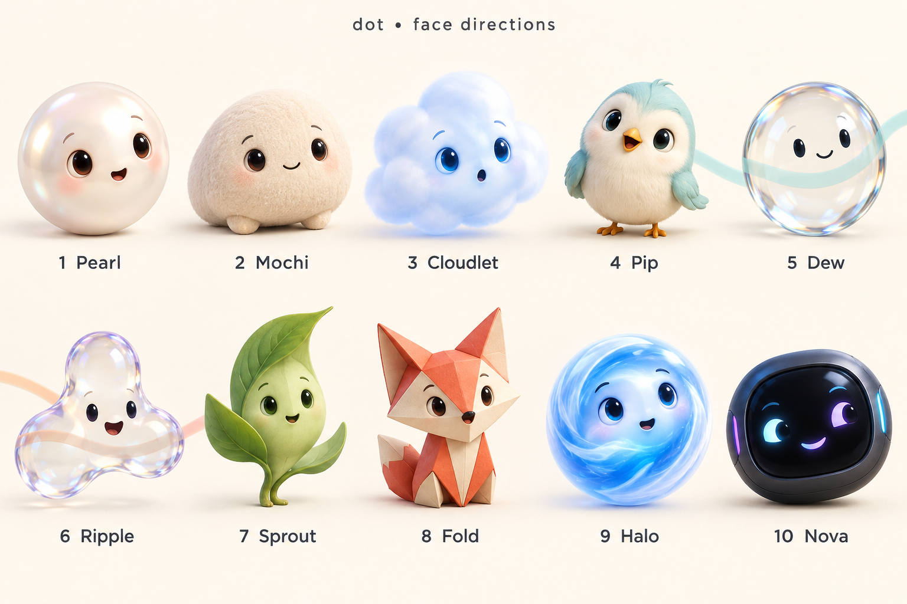

# dot: product roadmap and build checklist

Agreed direction, updated 2026-10-13. **This is the canonical future-product checklist.** [PROGRESS](PROGRESS.md) records verified source, tests and installation; agreement here does not mean a feature is built. All future capabilities below remain unchecked until verified. This publication changes documentation only; the preview review is complete and the previously approved first voice batch may resume. The native skin chooser is a separate batch; installation is not authorized by this publication.

dot is a very fast, voice-first, Apple-native macOS AI companion. **Speed comes first; a warm, calm, high-quality British female voice generated locally comes second.** It should understand relevant work, research facts, act helpfully and feel alive. Prefer Apple-native solutions and frameworks for every subsystem; use custom components where necessary or demonstrably better under these requirements. This principle preserves the fixed Splash/Qwen LLM and the required British voice.

Latest planning update, 2026-10-13: the user welcomed the suggestions for persistent tasks, verified actions and source-backed research, and requested **as little custom code as practical**, smooth behavior and publication of all planning deliverables. The user then explicitly approved starting with **the configurable listening and question follow-up loop**. Speech beginning within the invitation window continues until the selected trailing-silence rule; the invitation duration is not an utterance cutoff. The broader workflow recommendations below remain roadmap items, not completed capabilities or a promise to deliver the entire roadmap today.

**Latest decision: the owner reviewed and liked all ten directions and confirmed continuation.** The preview-before-build hold is resolved. Resume the already-approved configurable-listening and question-follow-up batch without asking for the same approval again; preserve the working installed app. Skin UI is a separate batch after the revised preview and shared interfaces are stable.

**Planning deliverables:** [downloadable plain-text checklist](BUILD_CHECKLIST.txt) · [historical v2 concept board](design/dot-face-directions-v2.png) · [unchanged v2 generation prompt](design/dot-face-directions-v2-prompt.txt) · [design artifact index](design/README.md). The v2 artwork still depicts Fold at position 8 and is explicitly **pre-Veil history**, not the final skin lineup. The revised v3 board and motion study are pending; no completed export or validation is claimed. The [first interactive preview](design/dot-ui-options.html) is also historical exploration.

**Agreed skin target:** **11 selectable choices in native Settings**: the existing **Original**, followed by ten new skins **Pearl, Mochi, Cloudlet, Pip, Dew, Ripple, Sprout, Veil, Halo, Nova**. **Original remains the default until the user changes it.** Veil replaces Fold at position 8: a very thin, nearly invisible transparent bubble/lens, similar to Dew but more transparent, with a sparse face, faint rim and visible backdrop; no fox or folded-paper form. The new grouping is four rounded, three glass, one Sprout and two AI-style skins. No new skin is implemented by this decision. Each new skin requires at least **120 reviewed, visibly distinct, context-appropriate named animation recipes**, each with trigger, duration, compatible states and cancellation behavior. Actual playback alignment and runtime performance require separate tests; a static board or Cartesian-product count does not complete the library.

**Standing documentation rule:** add new feature decisions and refinements to this canonical checklist and publish the updates to GitHub as they are discussed. The app should follow the current checklist. Record pending work honestly; do not wait for implementation to document an agreed requirement. Keep implementation authorization and evidence separate from documentation publication.

## Short improvement checklist

- [ ] **Fast voice first:** keep the chosen local model and British voice; measure the complete conversation path and let background work yield immediately to conversation.
- [ ] **Finish useful work:** persistent missions with a clear result, progress, pause/resume, restart recovery and checked outputs.
- [ ] **Remember with evidence:** editable local memory tied to source passages and dates, including corrections and stale information.
- [ ] **Research once, refresh intelligently:** a local evidence notebook with sources for individual claims, dates, disagreements and reusable findings.
- [ ] **Resume a project:** relevant files, recent decisions, unfinished tasks and a concise next-step or handoff pack.
- [ ] **Make documents useful:** watched-folder workflows, native PDF text and structured on-device recognition of scanned tables and lists.
- [ ] **Reuse reliable actions:** small tested native workflows for supported apps, with observable success and recovery where possible.
- [ ] **Offer timely help:** the requested 1 / 4 / 10-minute presets, default 1; prioritize useful changes, remember dismissals and avoid duplicate work.
- [ ] **Make the UI actionable:** old design plus ten new looks, expressive speech, clear activity states, source chips, task results and keyboard access.
- [ ] **Build less custom infrastructure:** Apple frameworks first, thin adapters, one shared model, one local store and measured staged Rust migration.

All boxes describe future work. No app capability is completed by this planning update.

## At a glance

| Area | Agreed target; not a completion claim |
| --- | --- |
| Local AI | Qwen 3.8 27B Q4 through Splash; current pinned baseline Splash 1.3.1 with target, draft and vision assets |
| App architecture | SwiftUI/AppKit UI, Rust core/coordination/tools/research/history, thin Swift Apple-framework adapters; staged migration measured against the working app |
| Speech | Local British female voice, Kokoro `bf_isabella` quality reference; benchmark native speech candidates without silently substituting voices |
| Turn ending | Configurable continuous silence **2 / 3 / 5 / 8 seconds; default 3**, before reasoning or research on the utterance |
| Question replies | After an actual final audible question, **3 / 6 / 9 / 12 / 20 seconds; default 6**, to begin speaking |
| Proactive activity | Native options: **Low every 10 minutes / Normal every 4 minutes / High every 1 minute; default High**; randomized question timing still to design |
| Context and research | Automatic screen awareness, relevant accessible files and background observation; internet always available for research, local AI processing/speech/memory |
| Pet and UI | Compact native UI, richer personality, safe routes plus tiny local idle-motion fallback; **11 native Settings choices: Original (default) plus ten new skins**, including Veil instead of Fold |
| Tools and records | Mac/browser/file/coding tools, verified outcomes, durable local text history, editable memory and project/task context |
| Delivery | Preserve complete offline owner bundle; future public verified first-launch downloader, hardware gates and proper distribution acceptance |

## Current authorization and first implementation scope

The user first approved the listening and question follow-up loop, then paused implementation to view the face options. The owner has now reviewed the directions, liked all ten and confirmed continuation. **That hold is resolved: resume the previously approved bounded voice batch without repeating the approval question.** Documentation publication remains authorized. The skin chooser and expression library are a separate batch after the revised preview and shared interfaces are stable; do not block the voice batch waiting for v3 artwork.

1. Publish new decisions and planning artifacts, keeping recommendations, implemented source, tested behavior and installed behavior separate.
2. Resume configurable trailing silence and question-only follow-up listening with native options, persistence, cancellation, final-audio gating and focused tests.
3. Use several parallel agents for bounded implementation, tests/review and documentation with non-overlapping ownership, shared interfaces and one integration owner.
4. Preserve the existing design, Qwen/Splash and British Kokoro voice for this first slice. The accepted future skin target is Original plus all ten new skins, with Original default; this is not ten implemented themes or a speech-engine replacement.
5. Deliver and validate the revised v3 board and motion study separately. Keep the published v2 board/prompt as historical provenance; it depicts the replaced Fold concept.
6. Report the exact changed revision, checks and remaining physical-device acceptance. Publishing docs or building a candidate does not change the installed app. Installation requires a separate clear installation step; preserve the working installed app and unpublished UI patch.

The first batch retains the existing Swift coordination and native Apple adapters. Persist and validate both timer settings, including defaults/migration. Use monotonic deadlines for silence and invitations, test speech starting at the invitation boundary, and retain the normal 60-second capture/sample bounds. Full successful generation and final synthesis/playback completion must gate validated turn-bound question intent; intermediate queue drains and punctuation alone do not grant microphone authority. Respect existing microphone permission and route state without repeated or spontaneous OS permission prompts; invalidate stale work on replacement turns, Stop, hiding/Quit, sleep, route/permission loss and relevant drag/menu transitions.

The resumed bounded first batch does not include new proactive scheduling, movement, research/file/tool autonomy, native skin implementation, a speech/model replacement, full Rust migration, installation or public release. Existing defaults govern unrelated choices. Profile the preserved baseline when available; distinguish selected silence, post-silence processing and first actual audible response, and do not claim improvement without comparable measurements.

The owner review and continuation decision resolve the earlier UI prerequisite. Only genuinely blocking implementation details need clarification; open v3 preview and animation work do not delay this bounded voice slice. Design acceptance is not implementation or device-test evidence.

## Verified baseline and preserved work

| State | Evidence and limits |
| --- | --- |
| Public source before this design-decision publication | `main` at [`7ab2c28`](https://github.com/Emin-dev/Dot/commit/7ab2c28dbabeba5bd778ffb6f4fdeffb7cc60a55), rechecked 2026-10-13; that earlier face-brief/hold commit changes documentation only and its hold is now resolved |
| Installed personal app | [`b26a145`](https://github.com/Emin-dev/Dot/commit/b26a14505bd2bc8e57264f1dfc934f778a8bd781), assembled, signed, installed and launched; later prose does not change its executable |
| Exact installed-source checks | [CI](https://github.com/Emin-dev/Dot/actions/runs/38417684255) and native verification: 190 XCTest, 109 SwiftPM, 129 Python, 44 static guards; zero warnings; real Whisper linking and complete assembly passed. Suites overlap; do not sum them as unique tests |
| Device/owner acceptance | Historical owner-confirmed voice and real screen-aware replies; the installed repair produced a permitted placement map. Fresh owner smoke test, broader physical drag/multi-display/Space use and clean second-Mac acceptance remain open |
| Preserved compact UI work | Already rebased onto `1d04b89`, reviewed, **unpublished and uninstalled**: nine-file patch, resulting tree `d0f53b46f9b4573fb6d4383caae8185ddab31dbe`. Receipt records 129 Python and 48 static guards historically passed; new Swift/UI tests not run. Compact errors, Show/Quit menu and question-policy/parser scaffolding exist; automatic question microphone integration remains inert |

Preserve original dirty workspaces, installed app, history and the unpublished patch. Inspect active writers and the intended integration base before applying it; never replace current files wholesale with an older snapshot. Do not reclassify historic checks as tests of a future merge.

## Architecture and performance

Current coordination is Swift and remains appropriate for the resumed bounded voice slice; a Rust rewrite is not a prerequisite to shipping that tested slice. The working voice path is native whisper.cpp `base.en` batch transcription, a bundled Python/Kokoro helper, and AVAudioEngine/AVAudioPlayer; placement uses ScreenCaptureKit/Vision. The requested Rust service core is not implemented. Splash remains the inference runtime: changing orchestration language does not by itself make model inference faster.

- [ ] Design staged Swift/Rust service boundaries for coordination, tool execution, research, indexing, history and memory; keep Apple framework adapters thin and the UI responsive.
- [ ] Keep Qwen 3.8 27B Q4, Splash 1.3.1 baseline and pinned target/draft/vision assets. No alternate cloud LLM or Apple Foundation Models replacement has been authorized. The `mlx-community` checkpoint publisher name is not an inference-engine switch.
- [ ] Jointly benchmark streaming STT candidates **Parakeet EOU** and **Apple SpeechAnalyzer**, including recognition quality, offline asset provisioning and contention with Splash. No winner is established.
- [ ] Evaluate native Core ML Kokoro only if it matches the desired British female voice and outperforms the working path. Keep `bf_isabella` as the quality reference. Exact identity versus a sufficiently similar British voice is open; an American-only substitution is unacceptable.
- [ ] Consider Apple built-in speech as an optional native speech profile; do not promise access to Siri's exact voice. Core ML is being considered for speech, not as a replacement for Splash/Qwen.
- [ ] Measure resident-model policies, prefix caching, streaming STT, sentence TTS, reduced copying/IPC, prioritization and cancellation. Keep animation/placement cheap and independent of the 27B model; do not run multiple 27B models for background tasks.
- [ ] Benchmark speech and Splash together across GPU/ANE/memory contention, quality, heat, battery and RAM. Keep full payload integrity, process ownership and cancellation checks.
- [ ] Report speech-end to **first audible response including the selected silence interval** (default three seconds), post-silence processing separately, cold/warm readiness, interruption latency and p50/p95. Scheduled playback is not measured audible sound. Deep research can take longer. No fastest-pipeline result, guaranteed three-to-five-second answer or Rust speed multiplier is established.

## Conversation and native options

- [ ] Expose trailing-silence choices **2, 3, 5, 8 seconds, default 3**. Require uninterrupted silence for the selected duration before reasoning or web research on that turn. Resumed speech resets the timer. Streaming transcription may run while listening; do not reason on an unfinished utterance. Pause/deprioritize background reasoning on foreground interaction.
- [ ] Expose question invitation choices **3, 6, 9, 12, 20 seconds, default 6**. This is the time to **begin speaking after dot's final audible question**, not TTS duration or maximum utterance length. No speech closes the microphone; speech begun in time continues until the selected trailing-silence threshold, subject to ordinary capture/sample limits (current overall bound: one minute).
- [ ] Use validated explicit question intent and successful complete generation plus **all final question audio actually finished** before arming the mic. Punctuation, quotations or rhetorical questions alone cannot arm it. An intermediate audio-queue drain is not final completion.
- [ ] Bind intent, synthesis, playback and capture to the current turn with stale callback cancellation, one-time continuation authority, echo protection and fresh microphone permission. No automatic OS permission prompt. Stop/click replacement, drag/menu, hiding, Quit, sleep, route changes and permission loss cancel pending listening.
- [ ] Apply the same bounded invitation to random proactive questions after their audible completion. There is no independent random microphone opening without a question.
- [ ] Preserve click-to-interrupt/Stop. Decide hands-free speech interruption, wake word, maximum automatic reply chain and measured echo-settle behavior; scaffold constants are not agreed product limits.
- [ ] Add these controls and the activity presets below in native settings/options. A compact native surface may preserve the style; exact presentation remains open. Earlier no-Settings-window wording must not erase the requested controls.

## Screen, files and online research

The user has authorized broad autonomous use of relevant screen content, documents/files, Work/Downloads, iCloud Drive and other accessible folders, including relevant screen/file information in web research. **Web requests may contain screen data; this permission is decided.** Local reasoning does not mean network-free web queries: online services receive the requests needed for research. No cloud LLM replacement or conversation-upload feature is authorized by this direction.

- [ ] Provide automatic screen awareness before answering and background observation without a fresh request, to discover useful context and proactively help. This expands the installed explicit-turn capture plus sparse local placement behavior; it is not installed today.
- [ ] Keep native permission grants, visible capture/pause controls and honest unavailable-context reporting. Broad autonomy does not bypass macOS consent, protected-system/keychain restrictions, provider rules or actual accessibility.
- [ ] Build a local file/document index with event/change-driven updates, relevance ranking, deduplication and background opportunity discovery. Avoid repeated whole-disk scans. Handle iCloud placeholders/downloads explicitly; accessible cloud documents are not necessarily already offline.
- [ ] Make online research/deep research the default before most factual answers and support automatic background research. Keep internet available as a product capability; report connectivity/provider failures honestly.
- [ ] Use multiple searches, actual page/PDF reading, original sources, publication/event dates, follow-up queries, conflict cross-checks and citations. Similar usefulness to Perplexity/ChatGPT is an aspiration, not proven parity.
- [ ] Choose search provider/budget, research time budget and whether a quick provisional answer precedes full research. Do not imply permission to send relevant context remains undecided.
- [ ] Treat screen, website, PDF, document and model content as untrusted data. Reading it never grants authority to override the user's goals, expand permissions or issue tool commands.

AI processing, speech and durable memory remain local. Web retrieval is a separate network-capable service; keep the inference/speech isolation boundaries while designing it. Existing plans exclude stored microphone audio and screenshots; retention of learned text facts remains a design decision.

## Proactive personality, movement and visual design

- [ ] Offer activity presets **Low/minimum every 10 minutes, Normal/average every 4 minutes, High/maximum every 1 minute; default High**. These replace the earlier two-to-five-minute cadence. Define how randomized proactive questions relate to presets, busy/quiet/fullscreen/call states and times with no useful idea; do not invent an unconditional speaking timer.
- [ ] Add very proactive context-aware suggestions, useful questions, breathing, blinking, gaze/head motion and varied reactions across idle/listening/thinking/researching/speaking states. Give the face expressive speech animation rather than a fixed smile: varied mouth shapes/visemes timed to actual speech where supported or aligned locally. Treat prototype expressions as illustrative, not proof of lip-sync accuracy. Keep pointer/gaze responsiveness distinct from mouth movement; prioritize relevance and avoid duplicate suggestions.
- [ ] Provide **11 selectable native Settings choices: Original plus Pearl, Mochi, Cloudlet, Pip, Dew, Ripple, Sprout, Veil, Halo and Nova**. Original remains default until changed. Veil replaces Fold; preserve the existing appearance while implementing skins as a separate batch after the revised preview and interfaces are stable. Several skins use native Liquid Glass/transparent or circular/fluid voice-mode treatments, with a larger expressive face. Prefer SwiftUI/Core Animation, configurable animation detail/motion and Apple accessibility. Selection of all ten for the roadmap is not evidence that any new skin is implemented.
- [ ] Avoid text, buttons, useful content and unsafe swept movement paths during normal roaming; preserve the installed conservative placement fixes, manual drag/pin/menu-bar recall, keyboard/accessibility access and compact native UI.
- [ ] Add a **distinct tiny local idle-motion fallback**: do not remain still for more than one minute; when no normal safe route exists, move very slowly by a very small amount around the current place so the pet feels alive. Decide whether this is character animation within the existing panel or movement of the whole panel, along with amplitude, speed, cursor handling and accessibility/pin/pause interactions. Do not claim the exception guarantees zero content overlap or silently restore indefinite stillness as the target.
- [ ] Test normal safe routing and this fallback separately across changing content/displays. Installed behavior still holds position on uncertainty or no safe route; it does not yet implement the new fallback. Exact safe semantic placement for every app/display is not complete.

## Mac tools, local records and delivery

- [ ] Provide native app launching, Accessibility-based click/type/navigation, supported browser operations, local file/document creation/editing/organization, coding/build/test tools, local document search and live web research.
- [ ] Build an executor that plans, executes, verifies results, recovers/retries within bounds and reports honestly. Honor the user's maximum-autonomy/no-repeated-app-confirmation preference within actual OS/provider restrictions. Validate tool arguments and targets; support action history, cancellation and recovery/undo where possible. Do not invent additional approval policies as already agreed. The first voice batch may resume after completed preview review and confirmation; this broader tools roadmap remains outside that batch.
- [ ] Add durable **local text history with Read / Copy / Delete**, editable local memory, project/task context and useful preference learning. Current history is RAM-only. Define bounded storage, learned-fact retention, review/edit/delete, failure and recovery behavior; do not store microphone audio or screenshots under the existing plan.
- [ ] Decide how long findings/reports fit the compact UI and requested native options without losing readable detail.
- [ ] Add version-matched access to dot's own source and Siri/App Intents integration.
- [ ] Research the separate **T3-Video-Wan2.2-5B** feature and Apple Silicon resource/runtime fit. It is not a dependency of the fast voice path and must not silently replace its models.
- [ ] Preserve a complete bundled offline owner app. Implement a public first-launch downloader for pinned, verified assets with progress, disk-space checks, interruption/retry, corruption handling and offline reuse; no external folder/server setup requirement. Offline core operation and online research are separate acceptance cases.
- [ ] Implement hardware/OS gates and test the intended **M4 Pro-class/36 GB minimum, 48 GB recommended**, with macOS 26.4+ for the selected Splash runtime. Reported personal test class is M5 Pro/48 GB. These targets are not universal certification or proof on a 36 GB device.
- [ ] Complete clean supported second-Mac acceptance, license/redistribution notices, suitable asset delivery, distribution signing/notarization and exact-artifact installer tests. Existing personal development signing and payload-free CI DMGs do not establish a public release.

## Research-backed improvements and concrete workflows

The user supported the general suggestions. The details in this section are engineering recommendations inferred from the cited capabilities and research; they are not measured speed claims, completed features or proof of cloud-assistant parity. Priorities describe suggested sequencing after the first conversation slice.

| Priority | Improvement and useful example | Smallest proposed implementation and completion evidence |
| --- | --- | --- |
| Next foundation | **Persistent missions.** “Research three options and maintain a brief” survives sleep, restart or a failed request. | One local journal records the goal, inputs, steps, outputs and pending effects. Resume completed work; reconcile a started-but-unconfirmed action before retrying. Test restart without duplicate outputs. |
| Next foundation | **Verified action receipts.** “Organize these PDFs” produces actual files and a record of what changed. | Typed actions declare preconditions and observable results; reread files/app state before marking done. Retain recoverable versions for local edits. Detect concurrent edits and preserve an explicit “outcome unknown” state when verification is unavailable. |
| Next foundation | **Evidence-backed memory.** “Use the budget I corrected yesterday” retrieves the correction and its source. | Local full-text retrieval with source, date, passage, hash and superseding facts; separate user preferences, observations and inferences. Editable/deletable records; stale-source handling. |
| Next foundation | **Reusable research notebook.** Comparisons retain the evidence for each important claim and refresh only stale findings. | Questions, sources, passages, claims and conclusions are linked. Check dates, source independence, contradiction and citation support; identify uncovered claims rather than adding decorative citations. |
| Next useful workflow | **Resume a project / handoff pack.** Return to a project and see recent decisions, relevant documents and unfinished work. | Incremental project index plus task journal; retrieve a small source-linked context bundle and export a brief. Spotlight metadata accelerates discovery; it is not the only source of truth. |
| Next useful workflow | **Watched-folder document worker.** A new PDF in Downloads becomes a checked summary, extracted table or project document. | File-change notifications, debounce partially written files, PDF text first, native Vision structure recognition for scans, deterministic numeric validation and source-page links. Rescan after missed/coalesced events. |
| Next useful workflow | **Reusable native action recipes.** A successful supported task can run again with new inputs. | Small parameterized recipes with app/version preconditions, typed inputs/outputs and success checks. Prefer native APIs, installed Shortcuts and supported scripting before Accessibility or visual interaction. Invalidate stale recipes instead of reusing screen coordinates. |
| Next useful workflow | **Event-aware proactive help.** An export finishes or a document changes; dot prepares the relevant follow-up once. | Keep the requested 1 / 4 / 10-minute cadence, default 1. Check cheap change signals and pending work first; remember dismissals and deduplicate ideas. Conversation has priority over all background inference. Whether an unchanged context still triggers a spoken check-in remains an open product choice. |
| Later extension | **Meeting preparation and follow-through.** Assemble relevant files and open questions before a meeting, then turn user-provided notes into tasks. | Native EventKit plus the local project index, with explicit calendar access and refresh after store changes. Calendar metadata does not supply meeting conversation content. |
| Later extension | **Select-to-delegate.** Select text or drop a file onto dot and choose explain, compare or make a task. | Native macOS Services, pasteboard and file drops; show the selected source. Keyboard/VoiceOver access to stop, repeat, open result and resume. Selection availability depends on the sending app. |

Evidence and implementation limits:

- Durable event histories motivate resumable work, but dot should use a small local journal, not add a workflow server. No local journal can guarantee that an arbitrary GUI action happens exactly once. See [Temporal event history](https://docs.temporal.io/encyclopedia/event-history) and [operation idempotency](https://docs.temporal.io/nexus/operations).
- Apple provides [coordinated file access](https://developer.apple.com/documentation/foundation/nsfilecoordinator), [file versions](https://developer.apple.com/documentation/foundation/nsfileversion) and [safe replacement/backup options](https://developer.apple.com/documentation/foundation/filemanager/replaceitemat(_:withitemat:backupitemname:options:)). These help with local documents; they do not undo sent messages or make all third-party actions transactional. Verification and recovery remain dot's responsibility.
- [SQLite FTS5](https://www.sqlite.org/fts5.html) is a compact starting point for local text retrieval. [LongMemEval](https://github.com/xiaowu0162/LongMemEval) provides useful tests for corrections, temporal reasoning and abstention; its results do not predict this model's performance. Add heavier retrieval only if measured retrieval failures justify it.
- [ALCE](https://aclanthology.org/2023.emnlp-main.398/) evaluates correctness and citation quality separately. A citation being present or reachable is not proof that it supports a claim. Dot should expose the supporting passage and distinguish unresolved evidence.
- [Spotlight queries](https://developer.apple.com/documentation/foundation/nsmetadataquery) can discover indexed metadata, while [persistent sandbox file access](https://developer.apple.com/documentation/security/accessing-files-from-the-macos-app-sandbox) can use bookmarks when applicable. Neither grants universal access or guarantees a complete index; permissions, exclusions and stale bookmarks need handling.
- Apple's [Vision document recognition](https://developer.apple.com/videos/play/wwdc2025/272/) runs on-device and extracts tables, lists and paragraphs. Use [native PDF text](https://developer.apple.com/documentation/pdfkit/pdfdocument/string) before rendering scans; recognition does not guarantee correct numbers or arbitrary Office layout. [FSEvents](https://developer.apple.com/library/archive/documentation/Darwin/Conceptual/FSEvents_ProgGuide/UsingtheFSEventsFramework/UsingtheFSEventsFramework.html) requires recovery for missed/coalesced changes.
- [App Intents](https://developer.apple.com/documentation/appintents) expose dot's own actions; third-party tools still need supported [Shortcuts](https://support.apple.com/en-au/guide/shortcuts-mac/apd455c82f02/mac), [scripting](https://developer.apple.com/documentation/scriptingbridge) or Accessibility adapters. A universal app-control permission is not supplied by App Intents.
- [App activation notifications](https://developer.apple.com/documentation/appkit/nsworkspace/didactivateapplicationnotification) and file events can reduce unnecessary polling. Apple's [background activity scheduler](https://developer.apple.com/library/archive/documentation/Performance/Conceptual/power_efficiency_guidelines_osx/SchedulingBackgroundActivity.html) is approximate and recommended for deferrable work at intervals of ten minutes or more. Use it for index maintenance, not the one-minute activity check or speech deadlines. Sleep can suspend activity; resume without a burst of overdue prompts.
- [EventKit](https://developer.apple.com/documentation/eventkit/ekeventstore/requestfullaccesstoevents(completion:)) and [store-change notifications](https://developer.apple.com/documentation/eventkit/updating-with-notifications) support calendar-aware preparation after native access is granted. [Services](https://developer.apple.com/documentation/bundleresources/information-property-list/nsservices), [pasteboard](https://developer.apple.com/documentation/appkit/nspasteboard) and [accessibility actions](https://developer.apple.com/documentation/appkit/nsaccessibilitycustomaction) provide native delegation and control surfaces.

## Less custom code, smoother execution

This is a maintenance and performance policy, not a lines-of-code contest. Keep clear state transitions, necessary tests and recovery even if they require code.

| Layer | Recommended approach | Avoid unless measurement or a real requirement justifies it |
| --- | --- | --- |
| Interface and animation | Existing SwiftUI/AppKit surfaces, native settings, Core Animation/SwiftUI state transitions, native accessibility and Liquid Glass where suitable | A web-app shell, custom widget toolkit or inference-driven animation loop |
| Apple integration | Thin Swift adapters for audio, SpeechAnalyzer evaluation, Core ML evaluation, ScreenCaptureKit, Vision, PDFKit, EventKit, Services and supported app automation | Recreating Apple behavior in Rust or adding duplicate implementations of each adapter |
| Core behavior | Existing Swift coordination for the bounded voice slice; staged Rust coordination, task journal, scheduling, retrieval and typed tool contracts for later work; one owner of each state | A full rewrite before baseline measurements, a generic plugin platform before concrete tools, or unnecessary services |
| Local records | One local SQLite store for task/history/evidence records; full-text search first; native file coordination where needed | An additional database server or embedding model before retrieval evaluation demonstrates a need |
| Inference | One shared resident Qwen/Splash engine, bounded context, available prefix reuse, explicit priorities/cancellation | A second 27B model for background work or assuming Rust alone accelerates model inference |
| Speech | Keep British Kokoro quality reference; compare complete native speech paths on the target Mac | An American-only voice, access to Siri's exact voice as a promise, or component microbenchmarks presented as user-perceived latency |
| Background work | Native change notifications, deduplication, cached extracted text, priority queues, thermal/power awareness | Constant full-screen OCR, repeated whole-disk scans or deep research on unchanged context every minute |
| Research | Small search/retrieval adapter, source parsing and local evidence records; reuse supported networking and document APIs | A new browser engine or unbounded agent loops to accomplish simple fetching |

Prefer a small in-process Swift/Rust interface for custom core calls when feasible. Retain existing Splash isolation and required helper boundaries; add another IPC boundary only for a concrete isolation or measured performance need. Native does not mean every component is made by Apple: the fixed Qwen/Splash runtime and British speech requirement remain explicit exceptions.

## UI improvements beyond appearance

- [ ] Keep the face as the quick interaction surface, with readable state text for listening, waiting, researching, acting, speaking, paused and unavailable. Distinguish real progress from decorative animation.
- [ ] Add a compact task/result card with **Open result**, **Sources**, **Pause/Stop**, **Resume** and **Undo where supported**. Show the action's actual outcome and any incomplete step.
- [ ] Show “Why this suggestion?” with the relevant file, screen context or research evidence; make suggestions dismissible and remember dismissals.
- [ ] Keep spoken summaries short and let longer research expand into a readable native panel or document preview. Use opaque readable text surfaces where transparency would hurt contrast.
- [ ] Offer drag-and-drop and a keyboard shortcut/macOS Service for explicit delegation; keep vital controls usable without facial animation, hover or a microphone.
- [ ] Preserve Original as the default and offer all ten accepted new skins in native Settings. The v3 preview remains pending; artwork is illustrative, and native glass, accurate speech synchronization and runtime performance require implementation and device checks.

## Recommended useful autonomy milestone after the first voice batch

Build one complete workflow before widening the tool catalogue: **research and maintain a local project brief**. Dot retrieves relevant local documents, researches current sources, writes a source-linked brief, verifies the saved output, remembers its evidence and refreshes changed findings. It pauses for conversation and resumes after interruption without repeating completed effects.

Measure complete task success, unsupported claims, duplicate effects, recovery, wrong file changes, unnecessary prompts, number of model calls, and voice latency during background work. Test restart, a changed input file, a failed request, a stale app view and an untrusted instruction embedded in a source. [OSWorld's execution-based evaluation](https://osworld-v1.xlang.ai/) motivates checking actual outcomes; no leaderboard establishes dot's capability. This workflow is a proposed next milestone, not an expansion of the initial approved implementation batch.

## Open decisions to resolve during planning and implementation

| Decision | What is already fixed |
| --- | --- |
| British voice identity and speech candidates | Local warm/calm British female; `bf_isabella` reference, no American-only fallback; compare full-pipeline quality/latency before replacement |
| Skin implementation, Settings presentation and long reports | All ten new skins plus Original are chosen for the roadmap; Original stays default. Veil replaces Fold. Revised v3 preview and native implementation are pending; timer/activity values remain fixed |
| Randomized questions, busy/quiet/fullscreen/calls and no useful idea | Low 10 / Normal 4 / High 1 minute, default High; question completion must precede any automatic mic invitation |
| Idle-motion form, amplitude, speed, cursor/accessibility/pin behavior | Tiny slow local fallback after at most one minute still; normal routes avoid useful content; no zero-overlap guarantee for the exception |
| Hands-free interruption, wake word and reply-chain bounds | Click-to-interrupt/Stop and selected silence/invitation timers are retained |
| Search provider/costs, time budget and provisional answers | Research before most factual answers, internet available, relevant screen/file context in requests already authorized |
| Learned-fact retention and memory presentation | Local editable memory/history, Read/Copy/Delete, existing exclusion of stored mic audio/screenshots |

## Future parallel work lanes

The owner has reviewed the directions and confirmed continuation, resolving the earlier hold. Resume bounded parallel voice work now, with shared interfaces and one integration owner; do not repeat the same approval question. The broader lanes below remain later roadmap work and preserve the working app and unpublished patch. Native skin UI is a separate batch after the revised preview and interfaces stabilize, with Original default; no replacement speech engine is authorized.

| Lane | Scope and handoff |
| --- | --- |
| Voice/runtime | Configurable turn timing, validated question/final-audio gate, speech candidates and joint Splash benchmarks; no LLM substitution |
| Screen/pet | Native design/options, screen context, expressive states, safe routes and separately specified tiny-motion fallback |
| Research/files/memory | Retrieval quality, citations, indexed relevant context, background scheduling, local records and retention |
| Mac tools | Typed native/AX/browser/file/coding adapters, execution verification, cancellation, bounded recovery and action history |
| Integration/verification | Rust/Swift contracts, resource priorities, preserved patch integration, regression tests, device acceptance and release evidence |

## Definition of tested completion

A box can be checked only for its stated scope with exact revision/artifact and evidence. Record **source implemented**, **automated checks passed**, **native/device behavior verified**, **installed**, and **owner accepted** separately. Planning, scaffolding, review or green model-free CI does not complete a capability.

- [ ] For each implemented slice, run relevant focused tests and required repository gates; document failures/unrun checks and any warning. Validate concurrency, cancellation, permission loss, errors and recovery.
- [ ] Exercise all selected silence and invitation values: resumed-speech resets; no LLM/research before the boundary; no-speech timeout; speech starting near invitation expiry; final-audio ordering; intermediate/repeated drains; invalid intent; stale turns; echo; route changes; Stop and permission revocation.
- [ ] Verify settings persistence, randomized proactive scheduling, foreground priority, fallback motion/accessibility and research/tool outcomes on the actual target Mac. Test offline speech/local memory separately from connected research and provider failures.
- [ ] Compare full-pipeline p50/p95, actual audible output, quality and resource use against the preserved baseline before replacing a working component. Keep device/display limitations explicit.
- [ ] Before installation, review the integrated exact candidate and run applicable native acceptance; preserve stable signing/permissions and recoverable prior app. Before public release, satisfy the separate [exact-artifact acceptance contract](offline-acceptance.md).

See [contributor guidance](../CONTRIBUTING.md), [verified progress](PROGRESS.md), [current screen contract](screen-context-contract.md), [current placement policy](roaming-policy.md), [voice bridge](voice-bridge.md) and [assembly plan](self-contained-build-plan.md). Historical implementation details remain useful evidence; this checklist governs the newly agreed future direction.

## Design comparison prepared for discussion

The owner reviewed and liked all ten revised directions, then confirmed resuming the first voice batch. The skin target is **11 choices in native Settings: Original plus ten new skins**. Original remains the default until changed. This resolves the preview-before-build hold; it does not install new skins or complete their animation library.

| Category | Accepted new skin directions | Intended distinction |
| --- | --- | --- |
| Four rounded | 1 Pearl, 2 Mochi, 3 Cloudlet, 4 Pip | Pearl ceramic, soft plush pebble, cloud puff and rounded bird; distinct silhouette, material and facial proportions |
| Three transparent glass | 5 Dew, 6 Ripple, 8 Veil | Clear bubble, tri-lobed droplet and an even thinner nearly invisible bubble/lens; visible backdrop and legible sparse face |
| One organic character | 7 Sprout | Sculptural leaf companion with its own body and motion vocabulary |
| Two AI-assistant faces | 9 Halo, 10 Nova | Flowing luminous voice orb and dark luminous visor; original faces without branded logos |

**Veil replaces Fold at position 8.** Its body should be like Dew but more transparent: a thin lens or bubble with a faint rim, minimal face and the background clearly visible through it. Do not preserve Fold's fox, paper folds or angular paper character under the new name. The current category split is **4 rounded / 3 glass / 1 Sprout / 2 AI**, superseding the older 4/2/2/2 split.

The **[v2 board](design/dot-face-directions-v2.png)** was completed, inspected and shown to the owner. It is published here as **historical pre-Veil concept art** and still illustrates **Fold**, which is no longer a final skin. Its [original generation prompt](design/dot-face-directions-v2-prompt.txt) is preserved byte-for-byte for provenance, including that superseded lineup. Neither artifact should be relabeled as the current final board.

The revised **v3 board and interactive motion study remain pending**; no completed export, runtime or validation claim is made. Publish their actual artifacts and evidence when delivered. The motion study's proposed 10 activity states × 12 presets = 120 selectable combinations per face is exploratory coverage, not 120 individually authored clips or a production library. Every new skin needs at least 120 reviewed, visibly distinct, context-appropriate named recipes; actual playback alignment, native rendering and runtime performance are separate acceptance work.

Activity states: Idle, Listening, Thinking, Researching, Speaking, Working, Question, Success, Uncertain, Resting. Expression presets: Calm, Curious, Warm, Focused, Delighted, Playful, Surprised, Concerned, Determined, Apologetic, Tired, Proud. These are presentation states, not claims that the software has human feelings. Keep task status readable separately from expression; avoid an identical smile for every state.

The pending study must make animation opt-in, silent and illustrative, respect Reduce Motion and avoid microphone activation, screen capture or research. Native glass, actual phoneme/audio alignment, energy use and real-device accessibility remain to validate in the app. Appearance review does not replace functional acceptance. Native skin UI follows in a separate batch once the revised preview and shared interfaces are stable; the voice batch can proceed now.

## Research-informed face and interaction requirements

- [ ] **Use a shared native rig for ten new identities while retaining Original.** Combine brows, eyelids, pupils/gaze, cheeks, mouth, head and body posture, with anatomy-specific controls such as wings or leaves. Prefer SwiftUI phase/keyframe animation and Core Animation before adding a custom rendering engine. A genuine 3D implementation would be a separate measured choice. [Apple animation timing](https://developer.apple.com/documentation/swiftui/controlling-the-timing-and-movements-of-your-animations)
- [ ] **Set a real production acceptance target:** at least **120 reviewed, visibly distinct, context-appropriate named animation recipes per new skin**. Every recipe needs a name, trigger, duration, compatible states and cancellation/interruption behavior. Exclude misleading combinations; counting a state/expression Cartesian product alone does not establish 120 useful animations. The planned interactive prototype's 120 selectable combinations are exploration, not 120 individually authored clips, a completed production library or real audio/phoneme synchronization.
- [ ] **Tie reactions to actual events.** Glance toward relevant content, respond visibly to listening, and celebrate only a verified result. [EMO](https://living.ai/emo/) advertises many combined expressions/actions; [Eilik](https://www.energizelab.com/eilik/) documents touch- and motion-triggered reactions. These are product examples, not evidence of proprietary rig architecture or a transferable performance benchmark.
- [ ] **Separate emotion from status.** Always expose clear listening/microphone, silence-countdown, researching, acting/verifying, speaking and reply-window state. A smile does not prove that the mic is off or that a task succeeded. Keep Stop, quiet/mute and keyboard access discoverable. [Apple feedback](https://developer.apple.com/design/human-interface-guidelines/feedback), [documented ChatGPT voice controls](https://help.openai.com/en/articles/8400625-voice-mode-faq)
- [ ] **Synchronize speaking to playback.** Use actual audio time and available or locally derived phoneme/viseme alignment; pause/cancel the face with audio. An amplitude-driven mouth is a fallback, not accurate phoneme synchronization. An audio player timeline does not itself generate visemes. [Apple audio timeline](https://developer.apple.com/documentation/avfaudio/avaudioplayernode)
- [ ] **Keep glass readable on real desktops.** Clear bodies may reveal underlying content, but eyes, mouth, activity labels and buttons need reliable contrast. Native material adaptation, Reduce Transparency/Increase Contrast alternatives and non-glass research surfaces are required. Illustrative refraction in artwork is not a native Liquid Glass implementation. [Apple Liquid Glass guidance](https://developer.apple.com/videos/play/wwdc2025/219/)
- [ ] **Make motion varied and bounded.** Use irregular blinking, small gaze shifts, short reactions and tiny idle movement; avoid constant large bouncing or repeated attention demands. Preserve the user's one-minute stillness requirement while resolving character motion versus whole-window drift. Reduce Motion needs a calmer alternative. [Apple motion guidance](https://developer.apple.com/design/human-interface-guidelines/motion), [Reduce Motion](https://developer.apple.com/documentation/swiftui/environmentvalues/accessibilityreducemotion)
- [ ] **Keep animation independent of Qwen.** Animate from task events and local deterministic timers; never invoke the LLM for each blink. Limit redraws to the pet, reduce hidden rendering and measure frame hitches and energy alongside voice latency. Native APIs alone do not prove a battery or speed advantage. [SwiftUI performance](https://developer.apple.com/documentation/xcode/understanding-and-improving-swiftui-performance)

The published historical v2 board is generated concept art, with the replaced Fold still visible. It is not the final Veil-inclusive board, a screenshot of a built application or a completed animation library. Its prompt is retained unchanged for reproducibility and review; the v3 board and motion study remain pending.

The [first interactive preview](design/dot-ui-options.html) is retained as historical, superseded exploration. It was previously checked at desktop/mobile widths; its later motion-state echo fix passed JavaScript syntax checks without a fresh browser check. Its optional presentation helpers use a CDN. Those results do not validate any future native rendering, the pending v3 board or the pending motion study. The [design artifact index](design/README.md) separates available artifacts from pending exports.

## Research references

- Apple SpeechAnalyzer: https://developer.apple.com/videos/play/wwdc2025/277/
- Apple Liquid Glass design and accessibility: https://developer.apple.com/videos/play/wwdc2025/219/
- FluidAudio speech recognition benchmarks: https://github.com/FluidInference/FluidAudio/blob/main/Documentation/Benchmarks.md
- Core ML Kokoro integration: https://github.com/FluidInference/FluidAudio/blob/main/Documentation/TTS/KokoroAne.md
- File-change notifications: https://developer.apple.com/documentation/coreservices/file_system_events

Public component benchmarks nominate candidates; they do not establish the fastest complete Dot pipeline or validate the desired British voice on the owner Mac.
